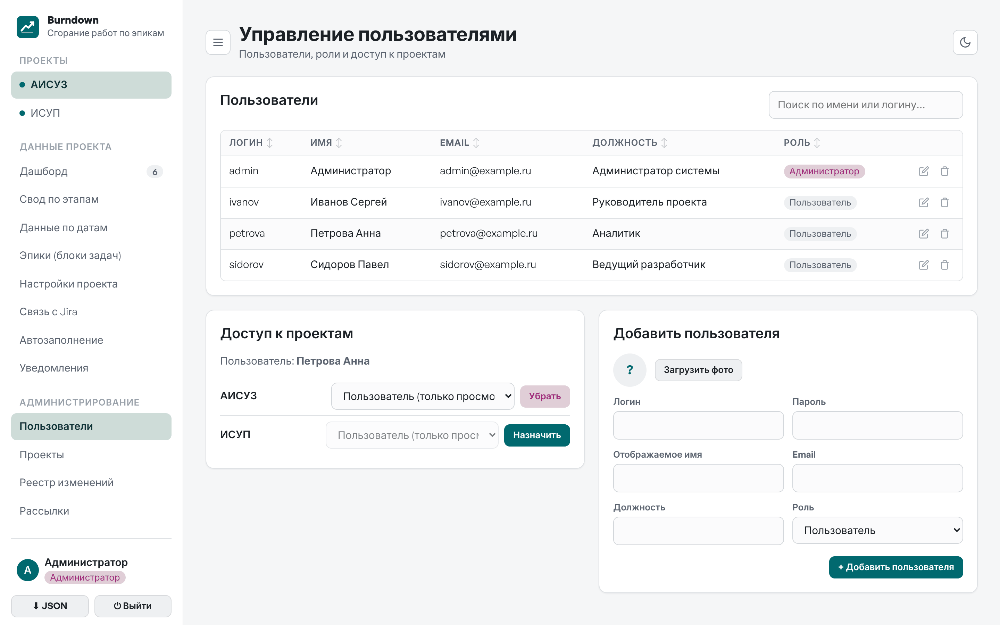
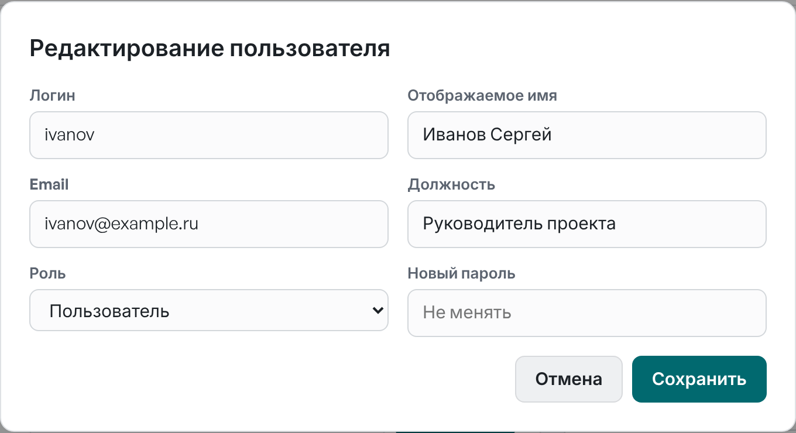
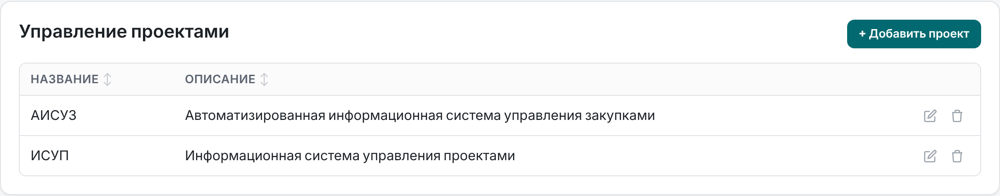
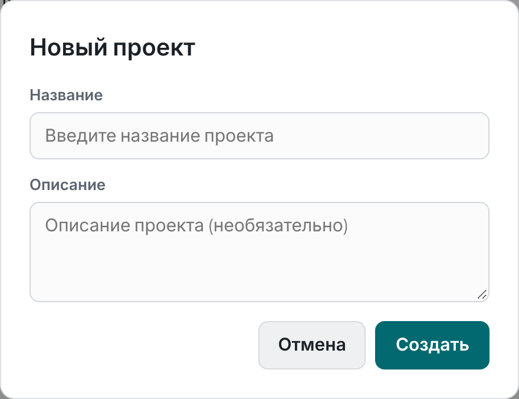
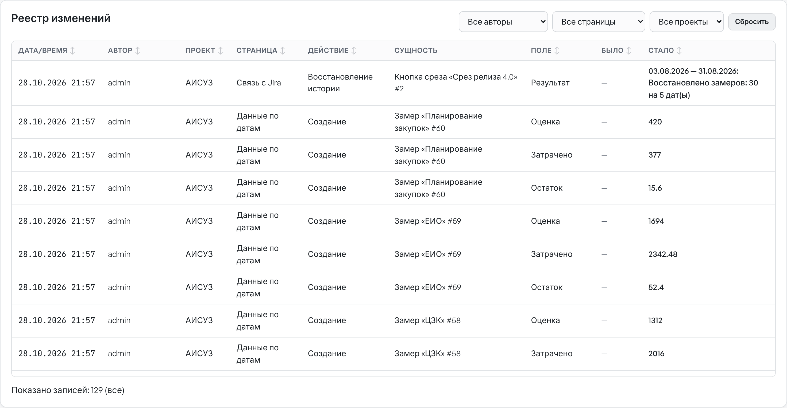
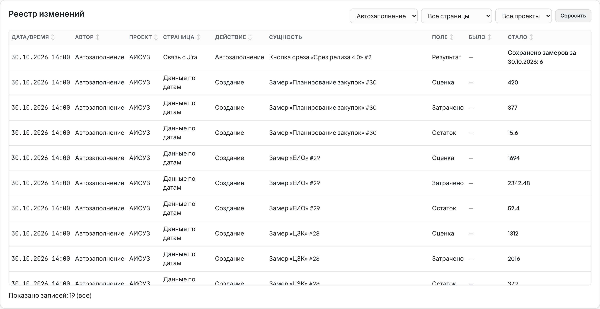
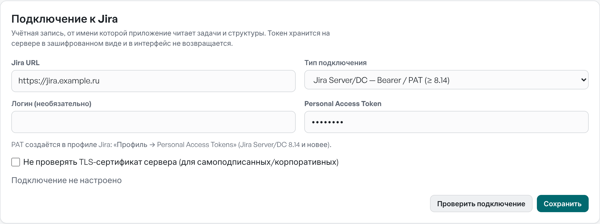
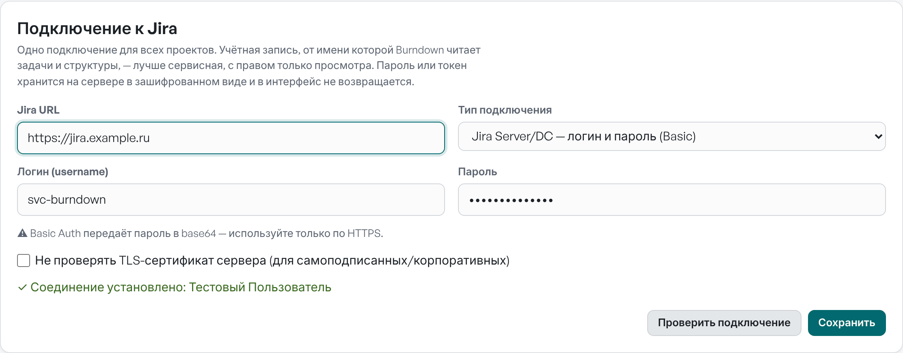
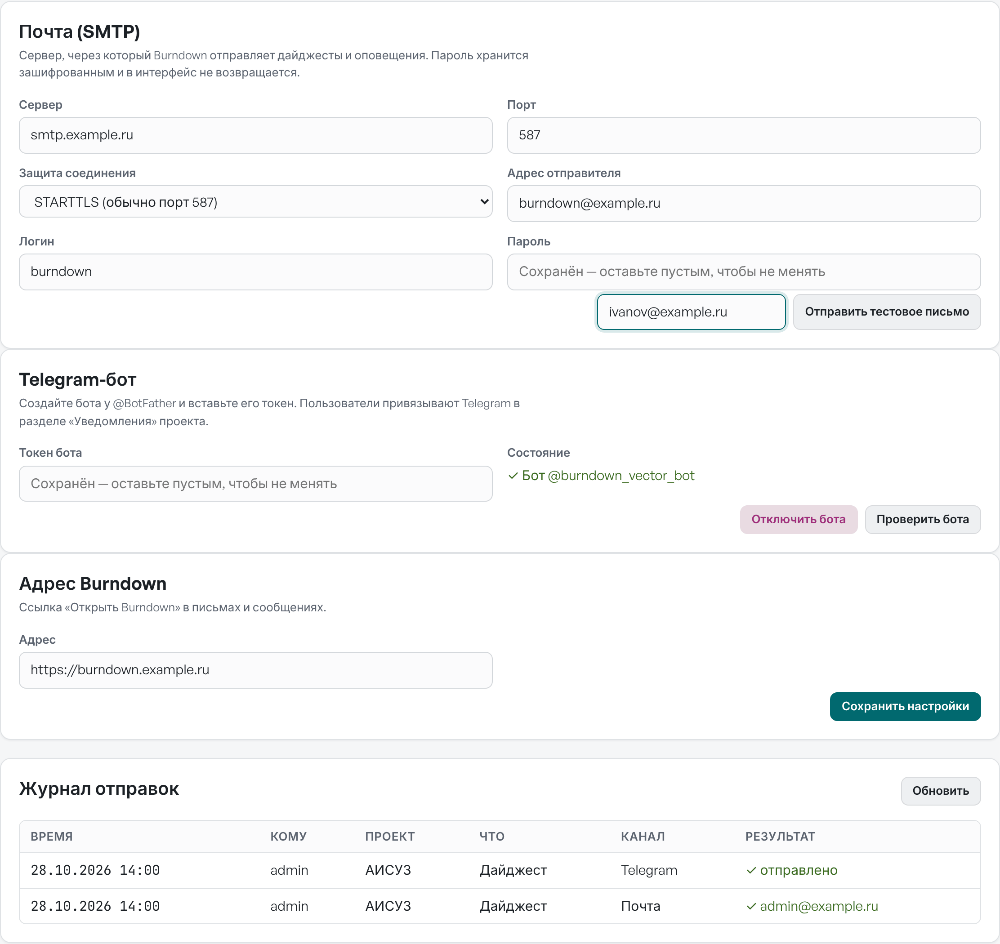
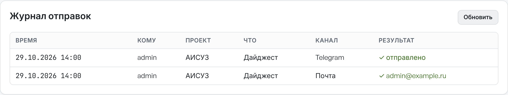

# О документе

Руководство описывает администрирование Burndown версии 1.6.1: учётные записи и роли, доступ к проектам, создание и удаление проектов, реестр изменений и экспорт, подключение к Jira и работу автозаполнения по расписанию, настройку рассылок — почты и Telegram-бота для дайджестов и оповещений, а также установку, обновление, резервное копирование и безопасность сервера.

Документ предназначен для администраторов Burndown и специалистов, обслуживающих сервер. Работа с дашбордом, замерами, эпиками, кнопками среза и расписанием автозаполнения со стороны руководителя проекта описана в «Руководстве пользователя».

Скриншоты сделаны на демонстрационных данных: проекты «АИСУЗ» и «ИСУП», пользователи Иванов (руководитель проекта), Петрова и Сидоров (пользователи).

**Условные обозначения**

| Обозначение | Значение |
| --- | --- |
| **Кнопка** | Название кнопки, пункта меню или поля на экране |
| «Раздел» | Название раздела, окна или блока |
| `команда` | Команда, файл или параметр сервера |
| > **Совет.** | Полезный приём |
| > **Важно.** | Ограничение или правило, которое стоит знать заранее |

# Роли и права

## Роли

| Роль | Где задаётся | Назначение |
| --- | --- | --- |
| **Администратор** | у пользователя | Полный доступ ко всем проектам и разделу «Администрирование»: пользователи, проекты, реестр изменений, интеграции (Jira, почта, Telegram), экспорт |
| **Руководитель проекта** | доступ к проекту | Ведёт данные проекта: замеры, эпики, целевые даты, настройки, кнопки среза Jira (какие задачи относятся к эпикам, поля), автозаполнение и восстановление истории |
| **Пользователь** | доступ к проекту | Только просмотр проекта: дашборд, свод, данные, эпики, отчёты PDF и печать |

Роли руководителя и пользователя назначаются отдельно для каждого проекта: сотрудник может вести один проект и только смотреть другой. Администратору назначения не нужны — он видит все проекты.

**Интеграции настраиваются централизованно.** Подключение к Jira, почтовый сервер и Telegram-бот — по одной настройке на весь Burndown; их задаёт только администратор в разделе «Интеграции». Руководитель проекта и пользователи видят только факт подключения — настроено оно или нет: адрес Jira, учётная запись, способ входа, почтовый сервер и имя бота им не показываются, а ошибки подключения приходят им без подробностей, с советом обратиться к администратору. В проекте он настраивает только связки: кнопки среза (структура, задачи Jira для эпиков, поля), расписание автозаполнения и восстановление истории.

| Настройка | Кто | Действует |
| --- | --- | --- |
| Подключение к Jira: адрес, способ входа, учётная запись, пароль или токен | администратор | во всех проектах |
| Почта (SMTP), Telegram-бот, адрес Burndown | администратор | во всех проектах |
| Кнопки среза: структура, задачи Jira для эпиков, поля Jira | руководитель проекта, администратор | в своём проекте |
| Расписание автозаполнения, восстановление истории | руководитель проекта, администратор | в своём проекте |
| Подписка на дайджест и оповещения | каждый пользователь сам | для себя, по проекту |

## Защита от ошибок

- Снять роль администратора с самого себя нельзя — это защищает от потери доступа к администрированию.
- Удалить самого себя нельзя.
- Удалённый пользователь теряет доступ сразу: его открытая сессия завершается при следующем запросе.
- Удаление проекта, эпика или замера требует подтверждения.

# Первичная настройка

## Первый вход

После установки (раздел «Установка и обновление») в базе есть администратор по умолчанию: логин `admin`, пароль `Test198!`.

1. Войдите под `admin`.
2. Откройте профиль (щелчок по имени внизу меню) и задайте новый пароль.
3. При необходимости удалите демонстрационные проекты «АИСУЗ» и «ИСУП» или используйте их для обучения.

> **Важно.** Смените пароль администратора по умолчанию до того, как откроете сервер пользователям. Пока пароль не сменён, в меню над кнопкой **Выйти** показывается предупреждение «Вы вошли с паролем по умолчанию — смените его»; щелчок по нему открывает профиль.

## Порядок настройки

1. **Проекты** — создайте проекты (раздел «Проекты»).
2. **Пользователи** — заведите учётные записи сотрудников.
3. **Доступ** — назначьте каждому сотруднику проекты и роль в них.
4. **Эпики и цели** — руководитель проекта заводит эпики, этапы и целевые даты, проверяет настройки прогноза.
5. **Интеграции** — администратор подключает Jira, почтовый сервер и Telegram-бота (раздел «Интеграции»).
6. **Кнопки среза** — руководитель проекта создаёт кнопки среза, выполняет первый срез и включает автозаполнение; пользователи сами подписываются на дайджест и оповещения.

## Административные разделы

Раздел «Администрирование» в боковом меню виден только администратору: **Пользователи**, **Проекты**, **Реестр изменений**, **Интеграции** (Jira, почта, Telegram-бот). Внизу меню у администратора есть кнопка экспорта текущего проекта в JSON.

{width=40%}

# Пользователи и доступ

## Список пользователей



- **Поиск по имени или логину** фильтрует список.
- Щелчок по строке выбирает пользователя: в блоке «Доступ к проектам» появляются его проекты и роли.
- Карандаш открывает редактирование, корзина — удаление.

## Доступ к проектам

Для каждого проекта в блоке «Доступ к проектам»:

- **Назначить** — открыть пользователю доступ;
- выбрать роль: **Пользователь (только просмотр)** или **Руководитель (редактирование)**;
- **Убрать** — закрыть доступ.

Изменения действуют сразу: при следующем действии пользователь увидит или потеряет проект.

## Создание пользователя

1. Заполните **Логин** и **Пароль** (обязательно), при необходимости — имя, email, должность и фото.
2. Выберите роль: **Пользователь**, **Руководитель проекта** или **Администратор**.
3. Нажмите **+ Добавить пользователя**. Новый пользователь сразу выбирается в списке — назначьте ему проекты.
4. Передайте сотруднику адрес Burndown, логин и пароль; пароль он сменит в профиле.

## Редактирование и удаление

{width=60%}

В окне редактирования меняются имя, email, должность, фото, роль и пароль (поле **Новый пароль** оставьте пустым, чтобы не менять). ФИО, email и должность пользователи сами не меняют — только администратор.

Удаление пользователя закрывает ему доступ ко всем проектам. Его записи в реестре изменений сохраняются.

# Проекты



- **+ Добавить проект** создаёт проект с настройками прогноза по умолчанию; название обязательно, описание — нет.
- Карандаш — переименование и правка описания.
- Корзина — удаление проекта со всеми эпиками, замерами, целями этапов, настройками, подключением к Jira, кнопками среза и расписаниями.

{width=60%}

> **Важно.** Удаление проекта необратимо. Перед удалением выгрузите проект в JSON.

## Экспорт проекта в JSON

Кнопка **JSON** внизу бокового меню выгружает текущий проект: название, описание, эпики, замеры, цели этапов и настройки. Файл подходит для архива и передачи данных в другие системы. Подключение к Jira и токены в экспорт не попадают.

# Реестр изменений

Реестр фиксирует, кто, когда и что изменил: эпики, замеры, цели этапов, настройки, проекты, пользователей, подключение к Jira, кнопки среза, расписания автозаполнения и результаты автозапусков. Для каждого изменения указаны поле, прежнее и новое значение.



- Фильтры по автору, странице и проекту сужают список; **Сбросить** снимает фильтры.
- Сначала загружаются 200 последних записей; **Показать ещё** догружает следующие.
- Таблица сортируется по столбцам; время показывается в часовом поясе вашего компьютера.
- Токены Jira в реестр не записываются: фиксируется только факт их изменения.

## Контроль автозаполнения

Автоматические запуски записываются от имени **Автозаполнение**. Выберите этого автора в фильтре, чтобы увидеть результаты запусков («Сохранено замеров за …» или текст ошибки) и созданные ими замеры.



Запуск по кнопке **Запустить сейчас** записывается от имени пользователя, который её нажал.

# Связь с Jira

Подключение к Jira одно для всех проектов. Его настраивает администратор в разделе «Администрирование» → **Интеграции**. Руководители проектов в разделе «Связь с Jira» своего проекта видят только, настроено ли подключение, и настраивают кнопки среза — какие задачи Jira относятся к эпикам.

Когда срез или автозапуск у руководителя завершается ошибкой подключения, он видит её кратко, без адреса Jira: «Не удалось подключиться к Jira — сообщите администратору…». Причину с адресом и подробностями показывает **Проверить подключение** в «Интеграциях». Пошаговая настройка кнопок и расписания описана в «Руководстве пользователя».

## Подключение к Jira Server / Data Center по логину и паролю



1. Попросите администратора Jira завести сервисную учётную запись (например, `svc-burndown`) с правом просмотра нужных проектов Jira и структур Structure. Так срезы не зависят от отпуска или увольнения сотрудника.
2. Откройте «Администрирование» → **Интеграции**, блок «Подключение к Jira».
3. **Jira URL** — адрес Jira, например `https://jira.example.ru` (если Jira открывается по пути — вместе с ним: `https://portal.example.ru/jira`).
4. **Тип подключения** — **Jira Server/DC — логин и пароль (Basic)** (выбран по умолчанию).
5. **Логин (username)** и **Пароль** сервисной учётной записи.
6. Если Jira использует самоподписанный или корпоративный сертификат, отметьте **Не проверять TLS-сертификат сервера** (лучше — добавить корневой сертификат компании в систему сервера).
7. Нажмите **Проверить подключение**: при успехе появится «✓ Соединение установлено» и имя учётной записи в Jira.
8. Нажмите **Сохранить**. Подключение сразу начинает работать во всех проектах: кнопки среза, автозаполнение и восстановление истории.



Особенности входа по паролю в Jira Server / Data Center:

- **только HTTPS** — при Basic-аутентификации пароль передаётся в каждом запросе;
- **CAPTCHA** — после нескольких неудачных входов Jira требует пройти проверку в браузере, и до этого отклоняет запросы Burndown. Burndown сообщит «Jira требует ввести CAPTCHA…»: войдите в Jira в браузере под сервисной учётной записью, пройдите проверку — срезы снова заработают;
- **смена пароля** — когда пароль сервисной учётной записи меняется по политике компании, введите новый в «Интеграциях» до его истечения, иначе автозапуски завершатся ошибкой 401 (её увидят подписчики оповещения «Автозаполнение не выполнено»);
- **вход по паролю отключён** — в некоторых Jira Data Center Basic-аутентификация запрещена; тогда выпустите для сервисной учётной записи Personal Access Token и выберите тип **Personal Access Token**;
- пароль может содержать русские буквы, но надёжнее — латиница, цифры и знаки.

**Отключить** удаляет подключение и пароль; кнопки среза во всех проектах сохраняются, но не работают до нового подключения.

## Требования

| Требование | Подробности |
| --- | --- |
| Сетевой доступ | Сервер Burndown обращается к Jira сам (не браузер пользователя): нужен доступ с сервера к адресу Jira по HTTPS |
| Прокси | Берётся из окружения процесса: `HTTPS_PROXY`, `HTTP_PROXY`, `NO_PROXY` |
| Учётная запись Jira | Право просмотра проектов и задач; для кнопок со структурой — право просмотра структуры |
| Плагин Structure | Для кнопок со структурой: Structure (Tempo, ранее ALM Works) с REST API `/rest/structure/2.0` (Jira Server/DC). Кнопки без структуры работают без плагина |
| Версия Jira | Server/DC — логин и пароль (любая версия) или PAT (8.14 и новее); Jira Cloud — email и API-токен |

Burndown только читает данные Jira: задачи, их поля, список полей и структуры. В Jira ничего не записывается.

## Типы подключения

| Тип | Аутентификация | REST API |
| --- | --- | --- |
| Jira Server/DC — логин и пароль (Basic) | Basic (логин и пароль, UTF-8) | `/rest/api/2` |
| Jira Server/DC — Personal Access Token | `Authorization: Bearer <PAT>` | `/rest/api/2` |
| Jira Cloud — email + API-токен | Basic (email и API-токен) | `/rest/api/3` |

Работа плагина Structure в Jira Cloud не проверялась. Если REST API Structure недоступен, Burndown сообщит «Плагин Structure недоступен в этой Jira» — используйте кнопки без структуры.

## Хранение пароля и токена

- Пароль или токен шифруется на сервере ключом, производным от `SECRET_KEY`, и хранится в базе в зашифрованном виде.
- Пароль не возвращается в интерфейс и не пишется в реестр изменений; изменения подключения записываются в реестр на странице «Интеграции».
- Сохранённый пароль отправляется только на тот адрес Jira, для которого он введён: при смене адреса его нужно ввести заново.
- Адрес Jira — только `https://хост[:порт][/путь]`: без логина в адресе, параметров «?» и «#». Перенаправления Jira не выполняются — если Jira отвечает перенаправлением (например, с `http://` на `https://`), срез сообщит итоговый адрес, который нужно указать в подключении. Текст ответа, не похожий на ошибку Jira, в сообщениях не показывается.
- Если `SECRET_KEY` сменился (или потерян файл `.secret_key`), сохранённые токены расшифровать нельзя: срез сообщит «Сохранённый токен не удаётся расшифровать (сменился SECRET_KEY сервера) — введите токен заново».

**Обновление с версий до 1.6.0.** Раньше подключение к Jira задавалось в каждом проекте. При обновлении общим становится подключение проекта, в котором больше всего кнопок среза; прежние записи в базе сохраняются. Если в проектах были разные адреса Jira, в журнале службы будет предупреждение — проверьте «Интеграции».

## Состав эпиков по задачам

С версии 1.2.0 каждый срез сохраняет состав эпиков по задачам Jira на день среза: ключ и тему задачи, статус и его категорию, остаток, затраченное время, оценку и признаки неполных данных. Из этих данных строятся блок «Задачи Jira по эпикам», burn-up эпика и список задач на дашборде.

- Дополнительно к полям учёта времени запрашиваются поля `summary`, `status` и `parent` — отдельных прав в Jira не требуется.
- Состав хранится в таблице `jira_issue_snapshots`: одна запись на задачу эпика в день; повторный срез за тот же день заменяет записи. Ориентир объёма: 6 эпиков по 200 задач при ежедневном автозаполнении — около 440 тыс. строк в год, это нормальная нагрузка для SQLite.
- Состав виден всем участникам проекта, включая роль «Пользователь»: темы задач Jira становятся доступны им в Burndown. Учитывайте это, если в темах бывают конфиденциальные сведения.
- Состав удаляется вместе с эпиком или проектом; удаление кнопки среза историю состава не удаляет.
- В экспорт проекта в JSON состав не входит — его можно получить заново из Jira.

## Восстановление истории

С версии 1.3.0 руководитель проекта может восстановить замеры и состав задач на прошлые даты по журналу изменений Jira (кнопка **↺ История** у кнопки среза).

- **Нагрузка на Jira.** Текущий срез, затем поиск задач с журналом изменений пакетами по 50 задач и один запрос списка статусов. В Jira Cloud поиск отдаёт журнал не полностью — для каждой задачи с историей выполняется отдельный запрос `/issue/{key}/changelog`. Запускайте восстановление больших структур вне часов пик.
- **Права.** Достаточно права просмотра задач; журнал изменений Jira отдаёт вместе с задачей.
- **Фоновая задача.** Восстановление выполняется в отдельном потоке процесса, ход сохраняется в таблице `jira_history_jobs`, интерфейс опрашивает его раз в секунду. Ограничения тайм-аута gunicorn на него не действуют. По одной кнопке одновременно идёт только одно восстановление.
- **Перезапуск сервера.** Восстановление, прерванное перезапуском, через 15 минут без обновлений помечается «прервано», и его можно запустить снова. Уже сохранённые даты при повторном запуске не дублируются: замеры с отметкой «не изменять» пропускаются.
- **Аудит.** Восстановленные замеры записываются в реестр от имени запустившего пользователя; итог — отдельной записью «Восстановление истории».

# Автозаполнение по расписанию

## Как это работает

- Расписание задаётся для каждой кнопки среза в разделе «Автозаполнение» проекта: дни недели, время, часовой пояс и режим перезаписи.
- Включить расписание можно только после первого успешного среза по кнопке, выполненного вручную.
- Планировщик — фоновый поток внутри процесса Burndown. Раз в 30 секунд он проверяет расписания и выполняет наступившие запуски.
- Каждая кнопка запускается один раз в день. День «захватывается» атомарно в базе, поэтому при нескольких воркерах gunicorn срез выполняет только один из них.
- Если в момент запуска сервер был остановлен, срез выполнится после старта в тот же день; пропущенные дни не догоняются.
- Замер сохраняется на текущую дату в часовом поясе расписания. Показатели без значения из Jira не затирают внесённые вручную.
- Результат пишется в карточку кнопки («Последний автозапуск») и в реестр изменений от имени «Автозаполнение».


## Настройка сервера

| Параметр | Назначение |
| --- | --- |
| `BURNDOWN_SCHEDULER=0` | Отключить фоновый планировщик в этом процессе (например, на тестовом стенде или в дополнительном экземпляре) |
| `TZ` сервера | На расписание не влияет: время запуска считается в часовом поясе, выбранном в расписании |

Планировщик запускается вместе с приложением — отдельной службы или cron не требуется. Он должен работать хотя бы в одном процессе Burndown: если планировщик отключён везде, расписания не выполняются.

> **Важно.** Сервер должен работать постоянно (systemd с `Restart=always`). При запуске вручную из терминала автозаполнение остановится вместе с терминалом.

## Диагностика

| Признак | Что проверить |
| --- | --- |
| В карточке ошибка 401 | Сменился пароль сервисной учётной записи или истёк токен — введите новый в «Интеграциях» |
| В карточке «Jira требует ввести CAPTCHA» | Войдите в Jira в браузере под сервисной учётной записью и пройдите проверку |
| «Не удалось подключиться к …» | Доступ с сервера к Jira, прокси (`HTTPS_PROXY`), DNS |
| «Ошибка TLS/сертификата» | Добавьте корпоративный корневой сертификат в систему или включите **Не проверять TLS-сертификат** |
| Последний автозапуск не обновляется | Работает ли служба (`systemctl status burndown`), не задан ли `BURNDOWN_SCHEDULER=0`, включено ли расписание и выбран ли сегодняшний день |
| Ошибки в журнале | `journalctl -u burndown` — сообщения журнала `burndown.autofill` |
| Срез или автозапуск идёт долго | `journalctl -u burndown | grep burndown.jira` — по каждому срезу, автозапуску и восстановлению истории записано число запросов к Jira и их время. Обычно 2–7 запросов на кнопку; если время большое при малом числе запросов — медленно отвечает Jira или сеть |

# Интеграции: почта и Telegram

Пользователи подписываются на дайджест по проекту и оповещения в разделе «Уведомления» проекта (см. «Руководство пользователя»). Чтобы сообщения уходили, администратор один раз настраивает каналы доставки в разделе «Администрирование» → **Интеграции** (под подключением к Jira).



## Почта (SMTP)

| Поле | Значение |
| --- | --- |
| **Сервер**, **Порт** | Почтовый сервер компании, например `smtp.company.ru`, порт 587 |
| **Защита соединения** | STARTTLS (обычно порт 587), SSL/TLS (обычно 465) или без шифрования (порт 25, только внутри сети) |
| **Адрес отправителя** | От чьего имени уходят письма, например `burndown@company.ru` |
| **Логин**, **Пароль** | Если сервер требует входа. Пустое поле пароля при сохранении оставляет прежний пароль |

Нажмите **Сохранить настройки**, затем введите свой адрес и нажмите **Отправить тестовое письмо** — так проверяются сервер, порт, шифрование и логин. При ошибке показывается понятная причина: «SMTP-сервер отклонил логин или пароль», «Не удалось отправить письмо через …» с текстом ошибки сервера.

Письма уходят на email из карточки пользователя — проверьте, что он заполнен у всех, кто будет подписываться.

## Telegram-бот

1. В Telegram откройте @BotFather, отправьте `/newbot`, задайте имя и логин бота (например, `company_burndown_bot`).
2. Скопируйте токен, который выдаст BotFather, в поле **Токен бота** и нажмите **Сохранить настройки**.
3. В поле **Состояние** появится «✓ Бот @…» — Burndown проверил токен и запомнил имя бота. **Проверить бота** повторяет проверку.

Пользователи привязывают свой Telegram сами: в «Уведомлениях» проекта нажимают **Привязать Telegram**, открывают бота по ссылке и нажимают **Запустить** (Start). Burndown находит это сообщение и запоминает личный чат пользователя.

**Отключить бота** удаляет токен; уже привязанные чаты сохраняются, но сообщения в Telegram не уходят, пока бот не подключён снова. Если подключить другого бота, пользователям нужно привязать Telegram заново: новый бот не может писать в чаты, начатые со старым.

## Адрес Burndown

**Адрес** — внешний адрес Burndown, например `https://burndown.company.ru`. По нему в письмах и сообщениях строится ссылка «Открыть Burndown». Если адрес не задан, ссылки в сообщениях нет.

## Журнал отправок



Внизу раздела «Интеграции» — последние 100 отправок: время, получатель, проект, что отправлено (дайджест, оповещение, тест), канал и результат. Ошибки видны с причиной — например, «Telegram не привязан» или «Forbidden: bot was blocked by the user», если пользователь заблокировал бота.

## Как работают рассылки

- Дайджесты и оповещения отправляет тот же фоновый планировщик, что выполняет автозаполнение (раздел «Автозаполнение по расписанию»): раз в 30 секунд он проверяет расписания дайджестов и изменения в проектах.
- Дайджест уходит один раз в день на подписку; день захватывается в базе атомарно, поэтому при нескольких воркерах gunicorn дубликатов нет.
- Оповещения проверяются, когда в проекте появились изменения — новая запись в реестре изменений или срез Jira. Сообщения сначала ставятся в очередь, затем доставляются; каждое сообщение отправляет только один процесс.
- Цифры в сообщениях считаются на сервере по тем же правилам, что и на дашборде, включая шанс успеть по методу Монте-Карло.
- Пользователь получает сообщения только по проектам, к которым у него есть доступ: после отзыва доступа рассылки по проекту прекращаются.
- Пароль SMTP и токен бота хранятся в базе в зашифрованном виде (ключ — `SECRET_KEY`) и в интерфейс не возвращаются.

## Требования к сети

- Доступ с сервера Burndown к почтовому серверу по выбранному порту.
- Для Telegram — доступ к `api.telegram.org` по HTTPS (порт 443). Если сервер выходит в интернет через прокси, задайте `HTTPS_PROXY` в окружении службы — его использует и связь с Jira, и Telegram.
- Входящие соединения не нужны: Burndown сам опрашивает бота при привязке, webhook не используется.

## Диагностика рассылок

| Признак | Что проверить |
| --- | --- |
| «SMTP-сервер отклонил логин или пароль» | Логин и пароль; у некоторых серверов нужен пароль приложения |
| «Не удалось отправить письмо через …: Connection refused / timed out» | Адрес и порт сервера, доступ с сервера Burndown (`nc -vz smtp.company.ru 587`), межсетевой экран |
| Ошибка сертификата при STARTTLS/SSL | Корпоративный корневой сертификат в системе сервера |
| «Telegram отклонил токен бота» | Токен у @BotFather (`/token`), не отозван ли он |
| «Telegram недоступен» | Доступ к `api.telegram.org`, `HTTPS_PROXY` |
| Письма не доходят, хотя в журнале «✓» | Папка «Спам», правила почтового сервера для адреса отправителя (SPF, DKIM) |
| Дайджесты не уходят совсем | Работает ли служба и планировщик (`BURNDOWN_SCHEDULER` не равен 0); ошибки — в `journalctl -u burndown` |

# Установка и обновление

## Требования

- Linux-сервер (проверено на Ubuntu 24.04), Python 3.10+.
- Nginx как обратный прокси и HTTPS (рекомендуется).
- Доступ с сервера к Jira — если используется связь с Jira; к почтовому серверу и `api.telegram.org` — если используются рассылки.

Внешние ресурсы из интернета приложению не нужны: Chart.js и шрифты лежат в `static/vendor`.

## Установка

```bash
sudo apt update && sudo apt install -y python3 python3-venv python3-pip nginx
sudo useradd -m -s /bin/bash burndown
sudo mkdir -p /opt/burndown && sudo chown burndown:burndown /opt/burndown
# скопируйте файлы приложения в /opt/burndown, затем:
sudo -u burndown bash -c 'cd /opt/burndown && python3 -m venv venv && \
  venv/bin/pip install -r requirements.txt && venv/bin/python init_db.py'
```

`init_db.py` создаёт базу `burndown.db` с администратором `admin` / `Test198!` и демонстрационными проектами.

> **Важно.** `init_db.py` пересоздаёт базу с нуля. Запускайте его только при первой установке — никогда при обновлении.

## Служба systemd

Файл `/etc/systemd/system/burndown.service`:

```ini
[Unit]
Description=Burndown Tracker (Gunicorn)
After=network.target

[Service]
User=burndown
Group=burndown
WorkingDirectory=/opt/burndown
Environment="PATH=/opt/burndown/venv/bin"
Environment="DB_PATH=/opt/burndown/burndown.db"
Environment="SESSION_COOKIE_SECURE=1"
ExecStart=/opt/burndown/venv/bin/gunicorn -w 4 -b 127.0.0.1:5000 app:app
Restart=always
RestartSec=5

[Install]
WantedBy=multi-user.target
```

```bash
sudo systemctl daemon-reload && sudo systemctl enable --now burndown
```

| Параметр окружения | Назначение |
| --- | --- |
| `SECRET_KEY` | Ключ подписи сессий и шифрования токенов Jira, пароля SMTP и токена Telegram-бота. Если не задан, генерируется и сохраняется в `.secret_key` рядом с базой (права 600) — обычно этого достаточно. Задавая явно, используйте `openssl rand -hex 32`: ключ короче 32 символов не используется, вместо него берётся `.secret_key`, а сохранённые токены перешифровываются автоматически |
| `JIRA_ALLOWED_HOSTS` | Необязательно: через запятую хосты Jira, к которым разрешено подключаться, например `jira.company.ru` или `.company.ru` (домен и поддомены). Без параметра — любой адрес |
| `DB_PATH` | Путь к файлу базы SQLite |
| `SESSION_COOKIE_SECURE=1` | Cookie сессии только по HTTPS — включайте, когда настроен HTTPS |
| `HTTPS_PROXY`, `NO_PROXY` | Прокси для запросов к Jira и Telegram |
| `BURNDOWN_SCHEDULER=0` | Отключить планировщик автозаполнения и рассылок в процессе |

Nginx проксирует запросы на `127.0.0.1:5000`; HTTPS настраивается через certbot. Полные примеры конфигурации — в `README.md`.

## Обновление

Сборка на сервере не нужна: приложение — Python и готовые статические файлы.

1. Сделайте резервную копию базы и `.secret_key` (раздел «Резервное копирование»).
2. Замените файлы приложения новой версией (например, `git pull` или копированием), не трогая `burndown.db` и `.secret_key`.
3. Обновите зависимости: `venv/bin/pip install -r requirements.txt` (в 1.1.0 добавлены `requests` и `cryptography` для связи с Jira; в 1.2.0–1.6.1 новых зависимостей нет).
4. Перезапустите службу: `sudo systemctl restart burndown`.
5. Попросите пользователей обновить страницу (Ctrl+F5).

Структура базы обновляется автоматически при запуске: новые таблицы и столбцы добавляются, существующие данные — пользователи, пароли, проекты, эпики, замеры, цели, настройки, реестр изменений, подключения к Jira и сохранённые токены — не изменяются. В 1.5.0 добавляются таблицы рассылок и подписок; до настройки рассылок администратором сообщения не отправляются. В 1.6.0 подключение к Jira становится общим: им становится подключение проекта, где больше всего кнопок среза (см. «Связь с Jira»). В 1.6.1 к составу задач добавляется признак восстановленного по истории среза; прежние записи считаются настоящими срезами.

Номер версии и «Историю версий» в приложении Burndown берёт из файла `docs/versions.md`, а руководства для кнопок «Открыть» и «Скачать» — из `docs/manuals`. Обе папки входят в поставку: при обновлении заменяйте их вместе с остальными файлами. Обновление проверено на базах всех предыдущих версий, начиная с первой.

Если после замены файлов забыть шаг 3, приложение всё равно запустится и будет работать с данными; недоступна будет только связь с Jira — с сообщением «На сервере не установлены библиотеки для связи с Jira… выполните pip install -r requirements.txt и перезапустите приложение».

# Резервное копирование и восстановление

Сохраняйте два файла:

- `burndown.db` — все данные;
- `.secret_key` (если `SECRET_KEY` не задан в окружении) — без него после восстановления пользователям придётся войти заново, а токены Jira, пароль SMTP и токен Telegram-бота — ввести заново.

Копия работающей базы без остановки службы (нужен пакет `sqlite3`: `sudo apt install -y sqlite3`):

```bash
sudo -u burndown sqlite3 /opt/burndown/burndown.db \
  ".backup /opt/burndown/backup/burndown-$(date +%Y%m%d).db"
```

Восстановление: остановите службу, замените `burndown.db` копией, запустите службу.

> **Совет.** Настройте ежедневную копию через cron и храните копии вне сервера. Для отдельных проектов дополнительно используйте экспорт в JSON.

# Сценарии администратора

## Сценарий А1. Новый проект

1. «Проекты» → **+ Добавить проект**, название и описание.
2. «Пользователи» → выбрать руководителя → **Назначить** проект с ролью **Руководитель (редактирование)**.
3. Остальным участникам — **Пользователь (только просмотр)**.
4. Руководитель проекта заводит эпики и цели, подключает Jira.

## Сценарий А2. Новый сотрудник

1. Заполнить форму «Добавить пользователя» → **+ Добавить пользователя**.
2. В «Доступе к проектам» назначить проекты и роли.
3. Передать адрес, логин и пароль.

## Сценарий А3. Сотрудник уходит из проекта или компании

1. Убрать доступ к проекту (**Убрать**) или удалить учётную запись.
2. Если подключение к Jira было настроено под его учётной записью — завести сервисную учётную запись и ввести её логин и пароль в «Интеграциях».

## Сценарий А4. Подключение Jira и первый проект с автозаполнением

1. Проверить с сервера доступ к Jira: `curl -I https://jira.example.ru`.
2. Получить у администратора Jira сервисную учётную запись (например, `svc-burndown`) с правом просмотра нужных проектов и структур.
3. В «Интеграциях» ввести адрес Jira, выбрать **Jira Server/DC — логин и пароль (Basic)**, ввести логин и пароль, **Проверить подключение**, **Сохранить**.
4. Сообщить руководителям проектов, что Jira подключена: в «Связи с Jira» их проектов появится «✓ Подключение к Jira настроено».
5. Руководитель проекта создаёт кнопку среза, выполняет первый срез и проверяет значения, затем включает расписание в «Автозаполнении»; на следующий день — проверить «Последний автозапуск» и реестр изменений.

## Сценарий А5. Сменился пароль сервисной учётной записи Jira

1. В карточке автозаполнения или при срезе — «Jira отклонила логин или пароль подключения (401)»; подписчики оповещения «Автозаполнение не выполнено» получают сообщение.
2. Ввести новый пароль в «Интеграциях» (поле пароля), **Проверить подключение**, **Сохранить** — подключение обновится сразу во всех проектах.
3. В «Автозаполнении» нужных проектов нажать **Запустить сейчас**, чтобы заполнить сегодняшний день.

## Сценарий А6. Перенос на новый сервер

1. Установить Burndown на новом сервере (без `init_db.py`).
2. Перенести `burndown.db` и `.secret_key` (или тот же `SECRET_KEY` в окружении).
3. Запустить службу и проверить вход, данные и срез из Jira.

## Сценарий А7. Подключение рассылок

1. Узнать у администраторов почты сервер, порт, тип шифрования и учётную запись для отправки (например, `burndown@company.ru`).
2. Проверить доступ с сервера: `nc -vz smtp.company.ru 587` и `curl -I https://api.telegram.org`.
3. В «Интеграциях» заполнить почту, **Сохранить настройки**, **Отправить тестовое письмо** себе.
4. Создать бота у @BotFather, вставить токен, сохранить и убедиться, что в **Состоянии** — «✓ Бот @…».
5. Указать **Адрес** Burndown для ссылок в сообщениях.
6. В своём проекте подписаться на дайджест, нажать **Отправить сейчас** и проверить письмо и сообщение в Telegram, а также запись в **Журнале отправок**.
7. Сообщить руководителям проектов, что подписка доступна в разделе «Уведомления».

# Рекомендации по безопасности

- Смените пароль `admin` по умолчанию сразу после установки.
- После 10 неудачных попыток входа с одного адреса вход под этим логином блокируется на 15 минут — так подбор пароля становится непрактичным.
- Смена пароля (самим пользователем или администратором) завершает все другие сессии этой учётной записи — так закрывается доступ с потерянного или чужого устройства.
- Подключение к Jira может изменить только администратор; дополнительно `JIRA_ALLOWED_HOSTS` ограничивает адреса Jira, к которым вообще можно подключиться.
- Работайте только по HTTPS и включите `SESSION_COOKIE_SECURE=1`.
- Задайте длинный случайный `SECRET_KEY` или защитите файл `.secret_key` (права 600) и включите его в резервные копии.
- Для Jira используйте сервисную учётную запись с правом только просмотра; вход по логину и паролю (Basic) — только по HTTPS. Если в Jira доступен Personal Access Token, он безопаснее пароля: его можно отозвать, не меняя пароль.
- Опцию **Не проверять TLS-сертификат** включайте только для доверенной корпоративной Jira; лучше добавить корневой сертификат компании в систему.
- Выдавайте роль «Администратор» минимальному числу сотрудников, ведение проектов — через роль «Руководитель проекта».
- Для рассылок заведите отдельную почтовую учётную запись с правом только отправки и используйте STARTTLS или SSL.
- Токен Telegram-бота даёт полный доступ к боту: не передавайте его, при утечке — `/revoke` у @BotFather и новый токен в «Интеграциях».
- Регулярно просматривайте реестр изменений и записи «Автозаполнения».

# Частые вопросы

**Пользователь не видит проект.** Проверьте в «Пользователях», назначен ли ему проект.

**Руководитель не видит «Связь с Jira» и «Автозаполнение».** У него роль «Пользователь» в этом проекте — назначьте **Руководитель (редактирование)**.

**Руководитель просит подключить свою Jira.** Подключение одно на весь Burndown и меняется только в «Интеграциях». Если задачи проекта лежат в той же Jira, но не видны в срезе, — выдайте сервисной учётной записи права на проект Jira или структуру.

**Где взять руководство пользователя для сотрудников?** В приложении: внизу бокового меню **Руководство** или **О программе** → **Открыть**, **Скачать PDF**, **Скачать Word**. Руководство администратора там же доступно только администраторам. Файлы берутся из `docs/manuals` на сервере.

**После перезапуска сервера всех выкинуло на страницу входа.** Сменился `SECRET_KEY` или потерян `.secret_key`. Верните прежний ключ; иначе пользователям нужно войти заново, а токены Jira — ввести заново.

**Автозаполнение выполняется дважды?** Нет: день запуска захватывается в базе атомарно, второй воркер или процесс запуск пропустит.

**Можно ли запускать автозаполнение чаще раза в день?** Нет, расписание — один запуск в день на кнопку. Для внепланового обновления используйте **Запустить сейчас** или срез вручную.

**Пользователь жалуется, что не приходят уведомления.** Найдите его в «Журнале отправок» раздела «Интеграции»: там результат каждой попытки с причиной ошибки. Если записей нет — у него не включён дайджест или оповещения, либо ещё не наступило время отправки.

**Можно ли разослать дайджест сразу всем?** Нет: подписка у каждого своя. Пользователь может нажать **Отправить сейчас** в своих «Уведомлениях».

**Нужно ли что-то собирать при обновлении?** Нет: замените файлы, обновите зависимости `pip install -r requirements.txt` и перезапустите службу.

**Что будет с данными при обновлении?** Структура базы дополняется автоматически, данные сохраняются. Не запускайте `init_db.py` на рабочей базе.
