# О документе

Руководство описывает повседневную работу в Burndown версии 1.5.0: дашборд сгорания по эпикам, свод по этапам, ввод замеров, список эпиков и настройки прогноза, связь с Jira — кнопки среза из Structure, автозаполнение замеров по расписанию и восстановление истории по журналу изменений Jira, состав эпиков по задачам Jira с burn-up, разбором изменений объёма и проверкой качества данных, прогноз диапазоном с вероятностью успеть к цели, дрейф прогноза, прогноз по burn-up и сводки задач Jira по этапам и проекту, дайджест по расписанию и оповещения на почту и в Telegram, выгрузку отчётов в PDF и печать.

Документ предназначен для руководителей проектов, которые ведут данные, и участников проектов, которые смотрят отчёты. Управление пользователями, проектами и доступом, реестр изменений, установка и обслуживание сервера описаны в отдельном «Руководстве администратора».

Скриншоты сделаны на демонстрационных данных: проект «АИСУЗ» с шестью эпиками и учебная Jira со структурой «АИСУЗ — релиз 4.0». У вас проекты, эпики и задачи будут свои. Набор кнопок зависит от вашей роли в проекте: если описанной кнопки нет, у вас нет права на это действие — обратитесь к администратору.

**Условные обозначения**

| Обозначение | Значение |
| --- | --- |
| **Кнопка** | Название кнопки, пункта меню или поля на экране |
| «Раздел» | Название раздела, окна или блока |
| Enter, Esc | Клавиши клавиатуры |
| > **Совет.** | Полезный приём |
| > **Важно.** | Ограничение или правило, которое стоит знать заранее |

# Знакомство с системой

## Назначение

Burndown — веб-приложение для контроля сроков по эпикам и этапам проектов. На каждую дату замера по эпику вносятся три числа — оставшееся время, затраченное время и оценка. По ним Burndown:

- строит графики сгорания остатка по эпикам и этапам;
- считает скорость сгорания (burn rate) по дням и в среднем;
- прогнозирует дату, когда остаток дойдёт до нуля, и сравнивает её с целевой датой;
- присваивает эпикам и этапам статусы «Успеваем», «Риск», «Не успеваем»;
- забирает остаток, затраченное время и оценку прямо из Jira — по кнопке или автоматически по расписанию.

Приложение работает в браузере, устанавливать ничего не нужно. Данные хранятся на сервере и доступны участникам проекта в соответствии с их ролями.

## Основные понятия

| Понятие | Что это |
| --- | --- |
| Проект | Самостоятельный набор эпиков, замеров, настроек и связи с Jira. Пользователь видит только проекты, к которым ему открыт доступ. |
| Эпик (блок задач) | Крупный блок работ внутри проекта — сервис, подсистема или бизнес-процесс. У эпика есть этап, название, целевая дата и отметка «Сдано». |
| Этап | Указывается у эпика, например «Этап 3.2». В своде эпики объединяются по основному номеру: «Этап 3.1» и «Этап 3.2» попадают в группу «Этап 3». |
| Группа в своде | Необязательное имя группы, которое заменяет группировку по номеру этапа. |
| Замер | Запись на дату по одному эпику: **Остаток** (сколько часов работы осталось), **Затрачено** (сколько часов потрачено), **Оценка** (текущая оценка объёма, ч). У эпика один замер на дату. |
| Burn rate | Сколько часов остатка «сгорает» в среднем за день. Отрицательное значение — остаток вырос; такие значения подсвечиваются красным. |
| Прогноз | Расчётная дата, когда остаток достигнет нуля: линейная регрессия по замерам или продолжение текущего burn rate. |
| Целевая линия | Прямая от последнего остатка к нулю на целевую дату — с какой скоростью нужно работать, чтобы успеть. |
| Δ оценки | Изменение оценки от первого замера до последнего. Рост оценки означает, что объём работ увеличился. |
| Кнопка среза | Настройка связи с Jira: структура, задачи Jira для каждого эпика и поля Jira для остатка, затраченного времени и оценки. По нажатию Burndown собирает данные из Jira и предлагает сохранить их как замер. |
| Автозаполнение | Расписание для кнопки среза: в заданные дни и время сервер сам забирает срез и сохраняет замер на текущую дату. |

**Статусы эпиков и этапов**

| Статус | Когда присваивается |
| --- | --- |
| ✓ **Успеваем** | Прогноз достигает нуля не позже целевой даты. |
| ⚠ **Риск** | Прогноз позже целевой даты, но в пределах буфера риска (по умолчанию 3 дня). |
| ✗ **Не успеваем** | Прогноз позже цели с учётом буфера, либо остаток не уменьшается («не сгорает»). |
| **Нет цели** | Замеры есть, но целевая дата не задана. |
| **Нет данных** | Недостаточно замеров для прогноза. |

## Роли в проекте

Роль «Администратор» действует во всех проектах. Роли «Руководитель проекта» и «Пользователь» назначаются отдельно для каждого проекта, поэтому в одном проекте можно редактировать данные, а в другом — только смотреть.

| Возможность | Администратор | Руководитель проекта | Пользователь |
| --- | :---: | :---: | :---: |
| Дашборд, свод по этапам, данные, эпики | ✓ все проекты | ✓ свои проекты | ✓ свои проекты |
| Фильтры, сортировка, выгрузка в PDF, печать | ✓ | ✓ | ✓ |
| Ввод замеров, эпиков, целевых дат | ✓ | ✓ | — |
| Настройки проекта | ✓ | ✓ | — |
| Связь с Jira, срез, автозаполнение | ✓ | ✓ | — |
| Пользователи, проекты, реестр изменений, экспорт | ✓ | — | — |

## Вход в систему

1. Откройте адрес Burndown, который сообщил администратор.
2. Введите **Логин** и **Пароль** и нажмите **Войти**.
3. Откроется «Дашборд» первого доступного проекта.

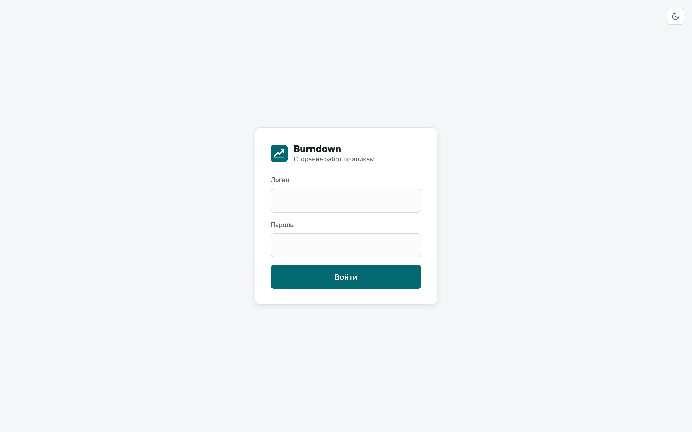

При неверных данных под полями появится сообщение «Неверный логин или пароль». Чтобы завершить работу, нажмите **Выйти** внизу бокового меню.

## Интерфейс

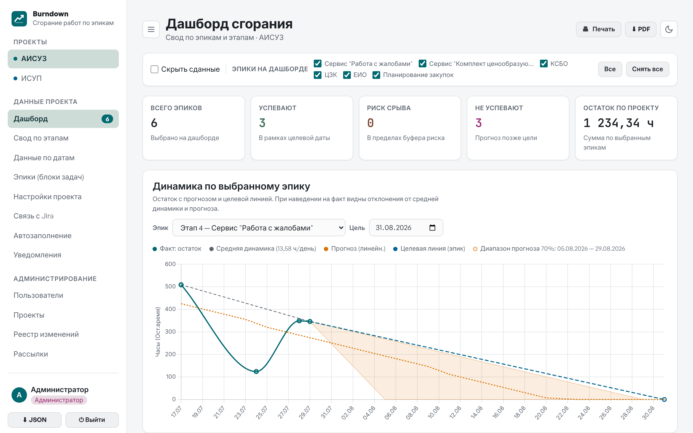

**Боковое меню** (слева):

- **Проекты** — доступные проекты; щелчок переключает проект, открытый раздел сохраняется;
- **Данные проекта** — разделы работы с проектом: **Дашборд** (число рядом — количество эпиков), **Свод по этапам**, **Данные по датам**, **Эпики (блоки задач)**, **Уведомления**; руководителю проекта также доступны **Настройки проекта**, **Связь с Jira** и **Автозаполнение**;
- **Администрирование** — только для администратора;
- внизу — ваше имя и роль (щелчок открывает профиль), кнопка **Выйти**.

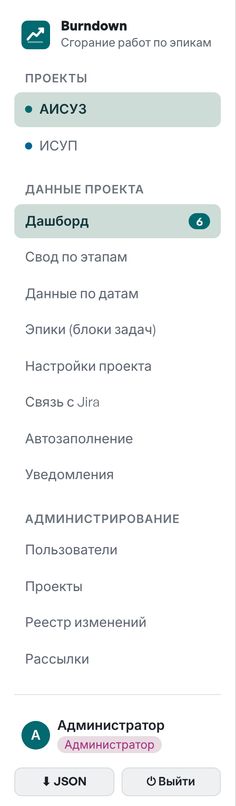{width=40%}

В окнах (новый проект, профиль, замер по всем эпикам и т. п.) Enter в поле ввода сохраняет, Esc закрывает окно без изменений. В подтверждении удаления кнопка по умолчанию — **Отмена**.

**Заголовок раздела** показывает название раздела и текущий проект. Справа — **Печать**, **PDF** (в разделах с отчётами) и переключатель темы. Кнопка **☰** слева от заголовка сворачивает и разворачивает меню.

## Тема оформления

Кнопка с луной или солнцем переключает светлую и тёмную тему. Выбор запоминается в браузере; если тема не выбиралась, используется тема операционной системы.

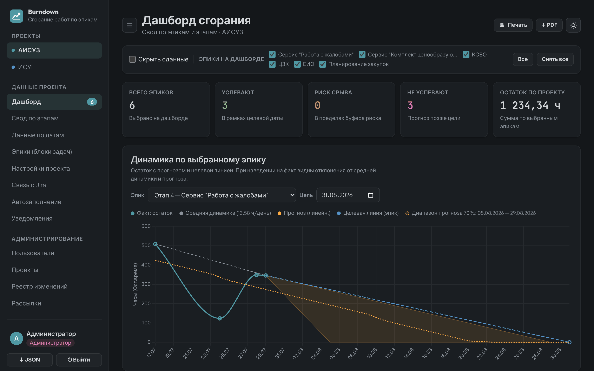

## Профиль

Щелчок по своему имени внизу меню открывает профиль.

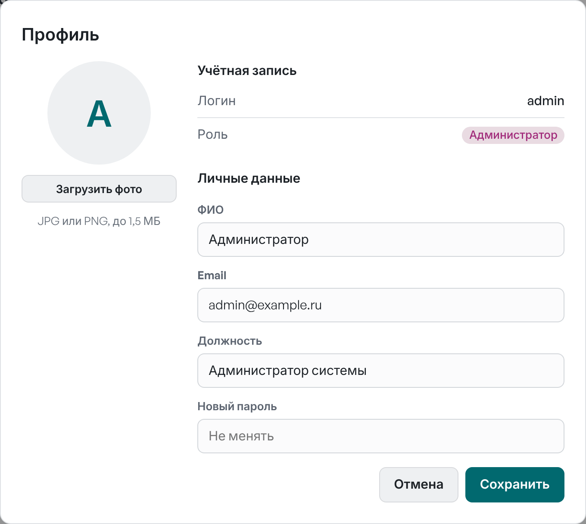{width=60%}

- **Загрузить фото** (JPG или PNG до 1,5 МБ) или **Удалить фото** — изменение применяется после **Сохранить**;
- **Новый пароль** — введите, чтобы сменить пароль; пустое поле оставляет пароль прежним;
- ФИО, email и должность меняет администратор.

# Дашборд

«Дашборд» показывает состояние всех эпиков проекта: ключевые показатели, графики, сводную таблицу и burn rate по дням. Если проект связан с Jira, на дашборде появляются ещё два блока — «Задачи Jira по эпикам» и burn-up выбранного эпика (раздел «Задачи Jira на дашборде»).

## Быстрые фильтры

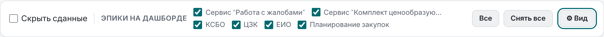

- **Скрыть сданные** — эпики с отметкой «Сдано» исключаются из показателей, графиков и таблиц дашборда;
- **Эпики на дашборде** — флажки эпиков: снимите флажок, чтобы временно исключить эпик из расчётов; **Все** и **Снять все** отмечают или снимают все флажки.

Фильтры не изменяют данные и доступны в режиме просмотра. Выгрузка дашборда в PDF учитывает выбранные эпики.

## Ключевые показатели

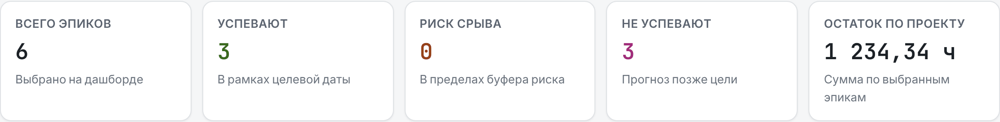

Карточки показывают, сколько эпиков выбрано, сколько из них успевают, в зоне риска и не успевают, а также суммарный остаток часов. Остаток берётся по последнему заполненному замеру каждого эпика.

## Динамика по выбранному эпику

Главный график показывает историю остатка одного эпика и его перспективу. Эпик выбирается в списке **Эпик**; в поле **Цель** руководитель проекта может сразу изменить целевую дату.

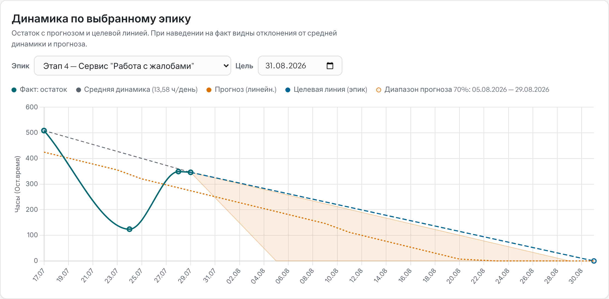

| Линия | Что показывает |
| --- | --- |
| Факт: остаток (сплошная) | Фактический остаток часов по датам замеров |
| Средняя динамика (серый пунктир) | Остаток при равномерном сгорании со средним burn rate |
| Прогноз (оранжевый пунктир) | Ожидаемое изменение остатка по выбранному методу прогноза |
| Целевая линия (синий пунктир) | Как должен сгорать остаток, чтобы успеть к целевой дате |
| Отметка «Сегодня» | Текущая дата, если она попадает в диапазон графика |
| Диапазон прогноза 70% (оранжевая заливка) | Между какими датами остаток обнулится с вероятностью 70% — см. «Прогноз диапазоном» |

Наведите курсор на точку фактического остатка: подсказка покажет значение и отклонения от средней динамики и от прогноза.

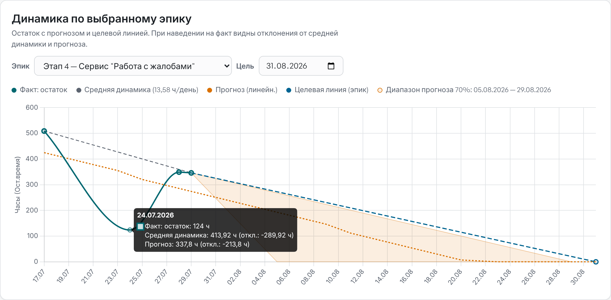

Ниже — два графика того же эпика: затраченное время и оценка.

## Графики по всем эпикам

Блок **Графики по всем выбранным эпикам** содержит три графика с линией на каждый эпик: остаток, затраченное время и оценка. Блок сворачивается щелчком по заголовку; состояние запоминается в браузере.

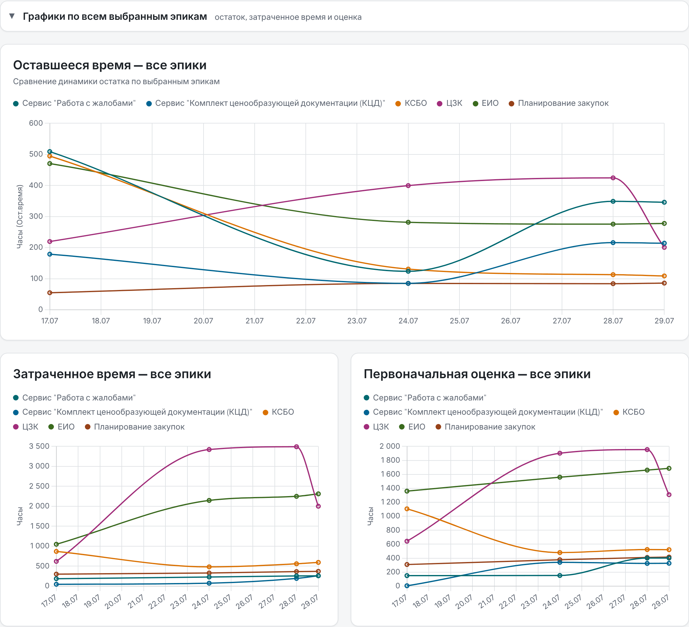

## Сводка по эпикам

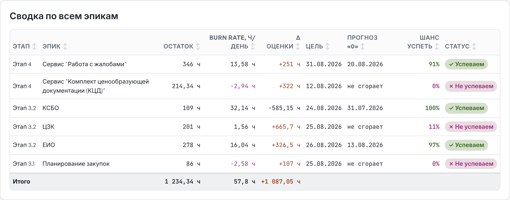

Для каждого эпика выводятся этап, текущий остаток, средний burn rate, **Δ оценки**, целевая дата, прогноз обнуления остатка, **шанс успеть** к цели и статус; в последней строке — итог по проекту.

- Щелчок по заголовку столбца сортирует таблицу, повторный — меняет направление.
- Отрицательный burn rate выделен красным, рост оценки — оранжевым.
- «не сгорает» в столбце прогноза: остаток не уменьшается, дату завершения спрогнозировать нельзя.
- Сданные эпики показаны приглушённым цветом.

## Прогноз диапазоном

Прогноз «0» — одна дата, а реальная скорость команды меняется от недели к неделе. Поэтому Burndown дополнительно моделирует будущее методом Монте-Карло:

1. Из истории замеров берутся интервалы между соседними замерами — с какой скоростью сгорал остаток и сколько дней длился интервал (с учётом метода burn rate из настроек проекта).
2. 2000 раз «проигрывается» будущее: интервалы выбираются случайно, чаще — более длинные, пока остаток не дойдёт до нуля.
3. Из 2000 сценариев получается распределение даты завершения.

| Показатель | Где виден | Что означает |
| --- | --- | --- |
| **Шанс успеть** | Сводка по эпикам и свод по этапам | Доля сценариев, в которых остаток обнулился к целевой дате. Зелёный — 80% и выше, оранжевый — 50–79%, красный — меньше 50% |
| **Диапазон 70%** | Заливка на графике эпика, легенда и подсказка в столбце «Шанс успеть» | От оптимистичной даты (P15: раньше неё завершается лишь 15% сценариев) до пессимистичной (P85: к ней завершаются 85%) |
| **Медиана (P50)** | Подсказка в столбце «Шанс успеть» | Дата, к которой завершается половина сценариев |

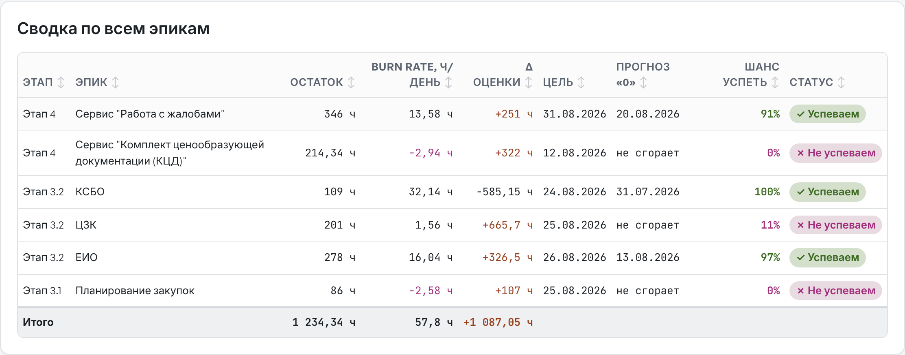

Для расчёта нужно не меньше трёх замеров остатка (двух интервалов); без цели шанс не считается, но диапазон в подсказке виден. Если остаток в истории чаще рос, чем сгорал, шанс будет низким, а в подсказке появится «не сгорает». Результат детерминирован: при тех же данных цифры не меняются от перерисовки к перерисовке.

> **Совет.** Статус и шанс успеть дополняют друг друга. «✓ Успеваем» при шансе 55% означает, что средний темп достаточен, но неровная работа команды делает срок рискованным.

## Дрейф прогноза

Панель «Дрейф прогноза» под графиками выбранного эпика показывает, какой была прогнозная дата завершения на каждую дату замера: Burndown пересчитывает прогноз так, как будто остальных замеров ещё не было.

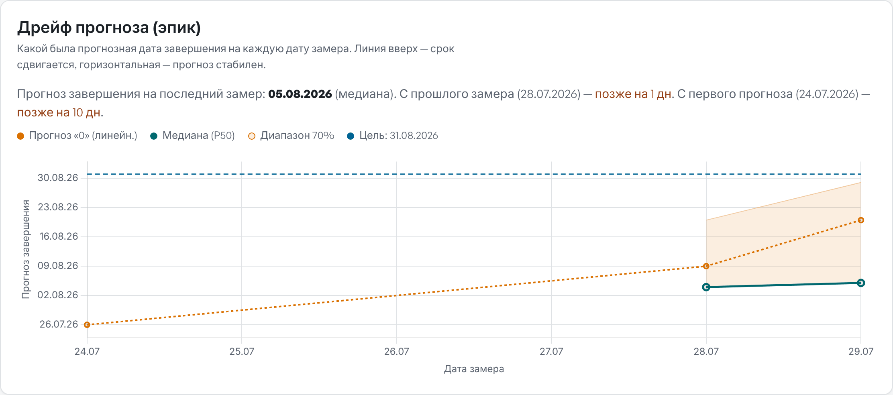

| Линия | Что показывает |
| --- | --- |
| Прогноз «0» (пунктир) | Прогноз выбранным в настройках методом — линейная регрессия или средняя скорость |
| Медиана (P50) | Медиана Монте-Карло — с третьего замера |
| Диапазон 70% (заливка) | От P15 до P85 на каждую дату замера |
| Цель | Текущая целевая дата эпика |

Над графиком — итог: прогноз на последний замер и насколько он сдвинулся с прошлого замера и с первого прогноза. **Линия, уходящая вверх, — тревожный сигнал**: срок каждый раз сдвигается, даже если статус пока «Успеваем». Горизонтальная линия — прогноз стабилен; линия вниз — команда опережает ожидания. Очень далёкие прогнозы (более года после цели) на графике не показываются.

## Таблица burn rate

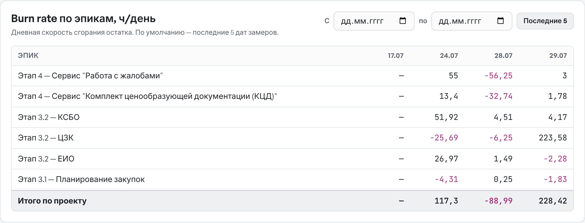

Таблица показывает скорость сгорания на каждую дату замера: разницу между предыдущим и текущим остатком, делённую на число дней между замерами. По умолчанию — последние 5 дат; другой период задаётся полями **С** и **по**, кнопка **Последние 5** возвращает период по умолчанию.

# Свод по этапам

Раздел показывает сгорание, суммированное по этапам. Вверху — карточки этапов с суммарным остатком, целевой датой и статусом.

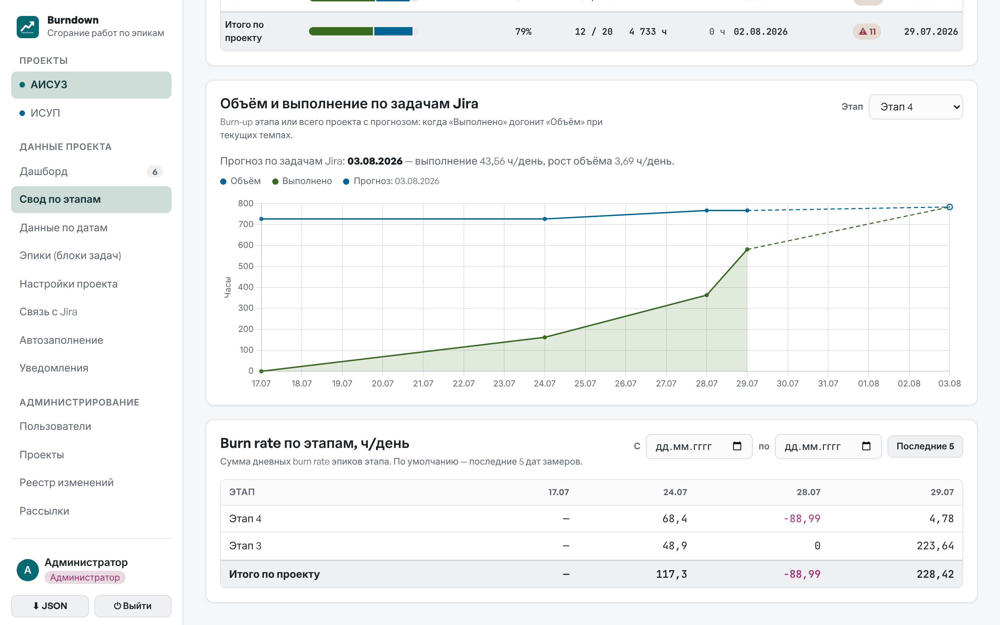

Флажок **Учитывать сданные эпики** включает сданные эпики в расчёты этапа; по умолчанию они не учитываются.

## График этапа

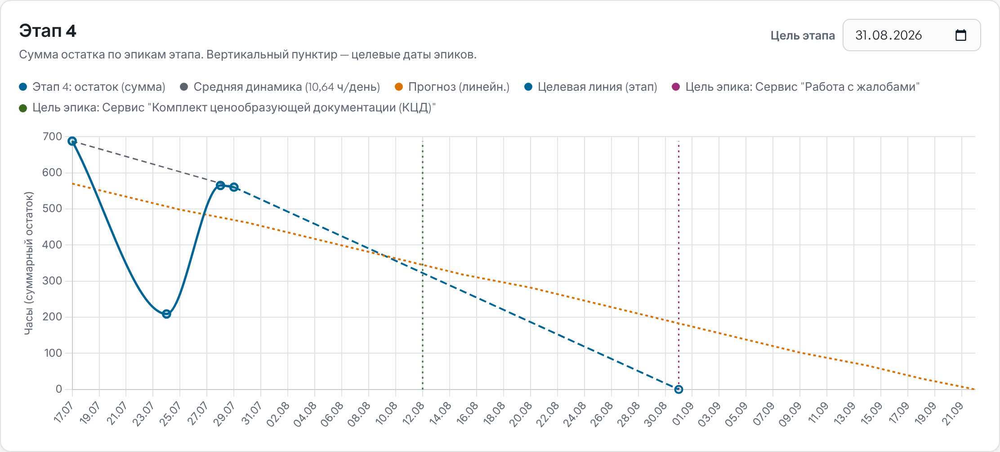

Для каждого этапа строится график суммарного остатка с теми же линиями, что и у эпика. Вертикальные пунктиры — целевые даты эпиков этапа. Целевая дата этапа задаётся в поле **Цель этапа** над графиком.

> **Совет.** Если в какую-то дату замер есть не по всем эпикам этапа, для остальных берётся их последний известный остаток — замеры в разные дни не дают ложных провалов на графике.

## Задачи Jira по этапам и по проекту

Если проект связан с Jira, в своде по этапам есть таблица «Задачи Jira по этапам»: те же показатели, что и у эпиков (состав задач, выполнено объёма, Δ объёма, прогноз по задачам, проблемы данных), суммированные по эпикам каждого этапа, и строка **Итого по проекту**. Такая же итоговая строка есть в «Задачах Jira по эпикам» на дашборде.

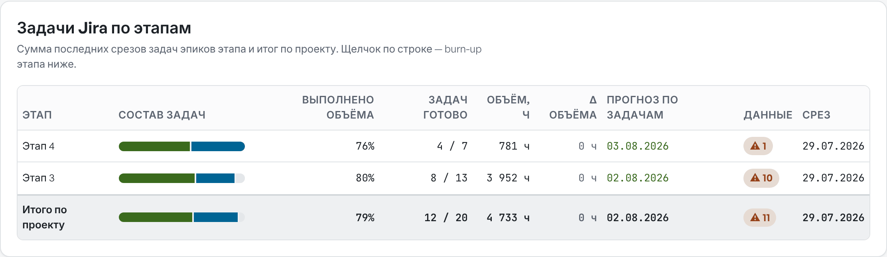

Ниже — burn-up этапа с прогнозом. Этап выбирается щелчком по строке таблицы или в списке **Этап**; вариант **Весь проект** показывает burn-up по всем эпикам со срезами.

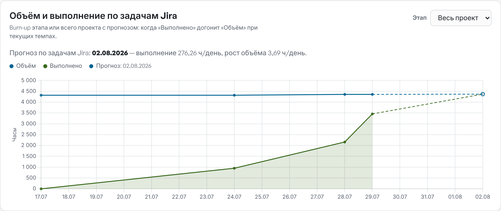

Если срезы эпиков сделаны в разные дни, для каждой даты берётся последний известный срез каждого эпика — так же, как в графиках этапов по замерам. В PDF-отчёт свода по этапам попадает таблица задач Jira по этапам с итогом по проекту.

## Сводка и burn rate по этапам

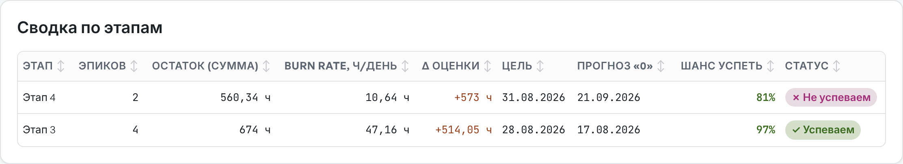

Сводка по этапам устроена как сводка по эпикам и дополнительно показывает число эпиков в этапе. Таблица burn rate по этапам складывает дневной burn rate эпиков, поэтому её итог совпадает с итогом таблицы на дашборде.

# Данные по датам

В разделе вносятся и правятся замеры. Изменения сохраняются автоматически при выходе из поля — внизу экрана на пару секунд появляется «Сохранено».

## Таблица замеров

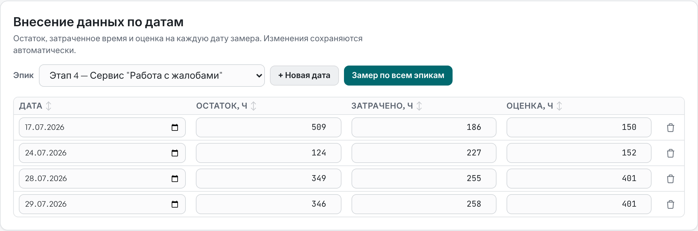

1. Выберите эпик в списке **Эпик**.
2. Нажмите **+ Новая дата** — появится строка с сегодняшней датой (если последний замер сделан сегодня или позже — со следующим днём).
3. Заполните остаток, затраченное время и оценку.

- **Enter** переводит к тому же полю в следующей строке, **Shift+Enter** — в предыдущей: удобно заполнять столбец целиком.
- Значения — числа не меньше 0, дробные допускаются (214,34). Пустое поле — значение не измерялось.
- На одну дату у эпика один замер: при выборе занятой даты появится сообщение, и дата вернётся к прежней.
- Если сервер не принял изменение (например, пропала связь), появится сообщение об ошибке, а в поле вернётся прежнее значение.

## Замер по всем эпикам

Обычно замер делают в один день по всем эпикам. Нажмите **Замер по всем эпикам** — откроется таблица всех несданных эпиков.

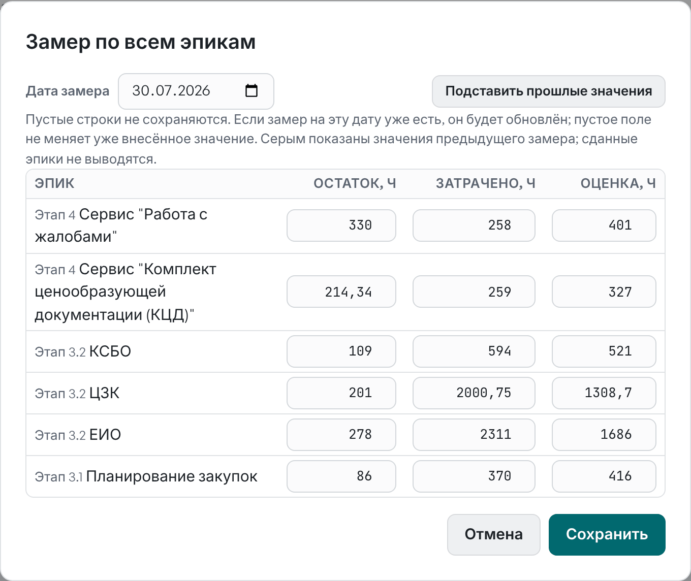{width=75%}

1. Укажите **Дату замера** (по умолчанию — сегодня). Если на эту дату уже есть замеры, их значения подставятся.
2. Серым в пустых полях показаны значения предыдущего замера; **Подставить прошлые значения** переносит их во все пустые поля.
3. Исправьте изменившиеся числа и нажмите **Сохранить**. Новые замеры создаются, существующие на эту дату — обновляются; пустые строки не сохраняются, а пустое поле не стирает значение, уже внесённое на эту дату. Чтобы очистить значение, сотрите его в таблице замеров.

## Удаление замера

Нажмите значок корзины в конце строки и подтвердите действие. Удаление необратимо.

{width=60%}

# Эпики (блоки задач)

Раздел содержит список эпиков проекта; поля редактируются прямо в таблице и сохраняются при выходе из поля.

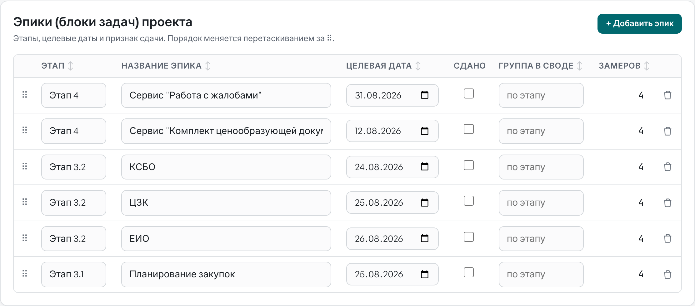

| Столбец | Назначение |
| --- | --- |
| ⠿ | Ручка перетаскивания: порядок эпиков используется во всех списках и на графиках |
| Этап | Этап эпика, например «Этап 3.2» — определяет группировку в своде |
| Название эпика | Наименование блока работ |
| Целевая дата | Срок завершения: по нему рассчитываются статус и целевая линия |
| Сдано | Отметка о сдаче. Сданные эпики можно скрыть на дашборде; в своде они по умолчанию не учитываются |
| Группа в своде | Необязательное имя группы для свода по этапам |
| Замеров | Сколько замеров внесено по эпику |

**+ Добавить эпик** создаёт эпик с этапом последнего эпика и сегодняшней целевой датой; корзина удаляет эпик вместе со всеми замерами.

> **Важно.** Удаление эпика удаляет его замеры без возможности восстановления. Если работа завершена, лучше поставить отметку «Сдано» — история сохранится.

# Настройки проекта

Раздел доступен руководителю проекта и администратору. Настройки действуют на все расчёты проекта и сохраняются сразу.

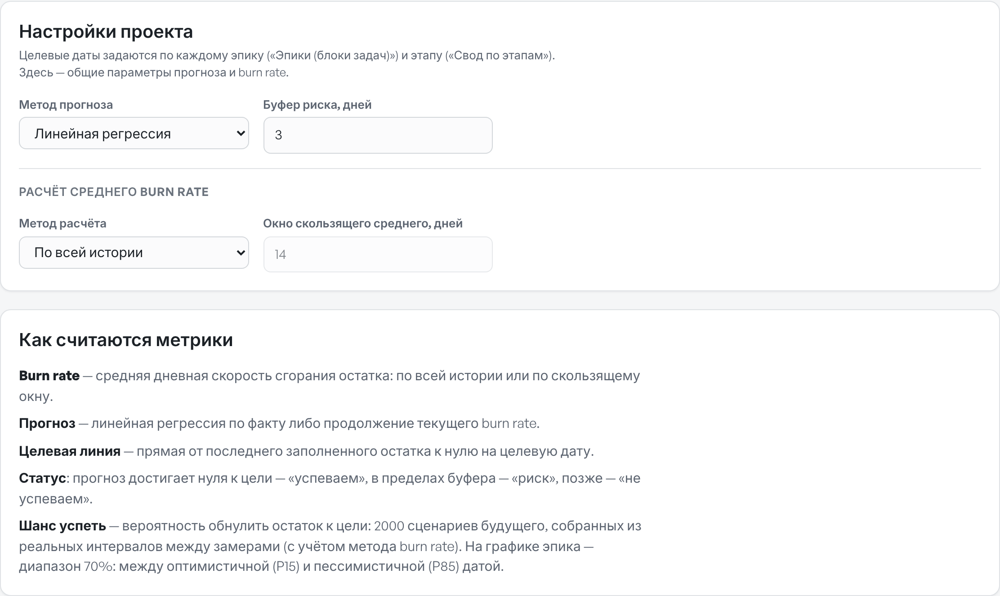

| Параметр | Описание |
| --- | --- |
| Метод прогноза | **Линейная регрессия** — прямая, наилучшим образом проходящая через все замеры. **Средняя скорость сгорания** — продолжение текущего burn rate от последнего остатка |
| Буфер риска, дней | На сколько дней прогноз может опоздать относительно цели, чтобы статус был «Риск», а не «Не успеваем» |
| Метод расчёта burn rate | **По всей истории** — от первого до последнего замера. **Скользящее среднее** — только за последние N дней |
| Окно скользящего среднего, дней | Ширина окна N для скользящего среднего |

# Связь с Jira

Связь с Jira избавляет от ручного переноса цифр: Burndown сам суммирует оставшееся время, затраченное время и оценку по задачам Jira, которые вы сопоставили с эпиками проекта. Настройка выполняется один раз для проекта и состоит из трёх шагов:

1. **Подключение** — адрес Jira и учётная запись, от имени которой Burndown читает задачи.
2. **Кнопка среза** — структура Jira, задачи для каждого эпика и поля Jira для остатка, затраченного и оценки.
3. **Срез** — по нажатию кнопки в «Данных по датам» Burndown показывает значения из Jira и сохраняет их как замер; после первого успешного среза можно включить автозаполнение по расписанию.

Разделы **Связь с Jira** и **Автозаполнение** видят руководитель проекта и администратор.

## Подключение к Jira

1. Откройте «Связь с Jira» и введите **Jira URL**, например `https://jira.example.ru`. Адрес `*.atlassian.net` автоматически переключает тип на Jira Cloud.
2. Выберите **Тип подключения**:

| Тип | Логин | Токен | Когда выбирать |
| --- | --- | --- | --- |
| Jira Server/DC — Bearer / PAT | необязательно | Personal Access Token | Jira Server или Data Center 8.14 и новее. PAT создаётся в профиле Jira: «Профиль → Personal Access Tokens» |
| Jira Server — логин + пароль | логин (username) | пароль | Старые версии Jira Server без PAT. Используйте только по HTTPS |
| Jira Cloud — email + API-токен | email | API-токен | Jira Cloud; токен создаётся на id.atlassian.com → Security → API tokens |

3. Если сервер Jira использует самоподписанный или корпоративный сертификат, отметьте **Не проверять TLS-сертификат сервера**.
4. Нажмите **Проверить подключение**. При успехе появится «✓ Соединение установлено» и имя пользователя Jira; при ошибке — её причина (неверный токен, нет доступа к адресу, ошибка сертификата).
5. Нажмите **Сохранить**.

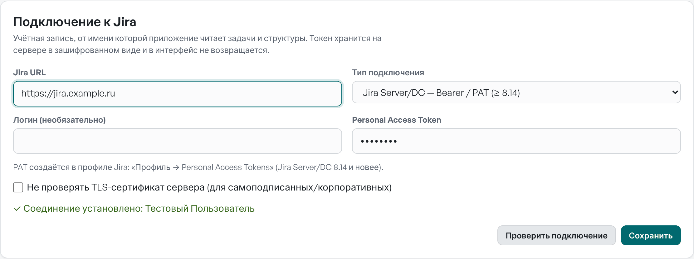

Токен хранится на сервере в зашифрованном виде и в интерфейс не возвращается: в поле показывается «Сохранён — оставьте пустым, чтобы не менять». При смене адреса Jira токен нужно ввести заново. **Отключить** удаляет подключение и токен; кнопки среза сохраняются, но не работают до нового подключения.

> **Совет.** Используйте отдельную учётную запись Jira с правом просмотра нужных проектов и структур — тогда срез не зависит от отпуска или увольнения сотрудника.

## Кнопка среза: структура и задачи

Кнопка связывает эпики проекта с задачами Jira. Кнопок может быть несколько — например, по разным структурам или для разных групп эпиков. Нажмите **+ Новая кнопка** в блоке «Кнопки среза из Structure».

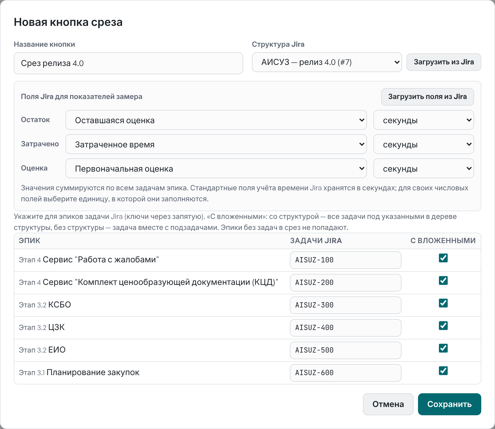

1. **Название кнопки** — так кнопка будет подписана в «Данных по датам».
2. **Структура Jira** — нажмите **Загрузить из Jira**, чтобы получить список структур плагина Structure, и выберите нужную. Пункт **Указать ID вручную…** позволяет ввести номер структуры. Пункт **без структуры** означает, что вложенность задач определяется связью «задача — подзадача» в Jira.
3. В таблице эпиков укажите **Задачи Jira** — один или несколько ключей через запятую (например, `AISUZ-100` или `AISUZ-301, AISUZ-302`). Регистр не важен.
4. Флажок **С вложенными** определяет, какие задачи суммируются:

| Структура | «С вложенными» | Что суммируется |
| --- | --- | --- |
| выбрана | ✓ | Указанные задачи и всё их поддерево в структуре (каждая задача — один раз) |
| не выбрана | ✓ | Указанные задачи и их подзадачи в Jira |
| любая | — | Только указанные задачи |

Эпики, у которых задачи не указаны, в срез не попадают. Чтобы забирать данные по всем эпикам проекта, заполните задачи у каждого эпика.

## Кнопка среза: поля Jira

В блоке «Поля Jira для показателей замера» выбирается, из каких полей Jira берутся три показателя замера.

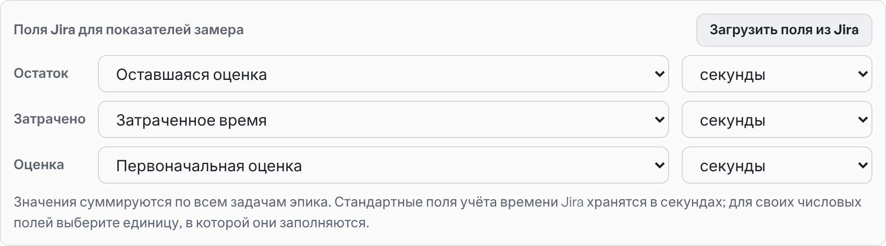

- По умолчанию используются стандартные поля учёта времени Jira: **Остаток** ← «Оставшаяся оценка», **Затрачено** ← «Затраченное время», **Оценка** ← «Первоначальная оценка». Они хранятся в Jira в секундах и пересчитываются в часы автоматически.
- **Загрузить поля из Jira** добавляет в списки числовые поля вашей Jira, в том числе пользовательские (например, «Трудозатраты, ч»). Для своего поля выберите единицу — **часы** или **секунды**: в чём поле заполняется в Jira.
- **— не заполнять —** — показатель не берётся из Jira. При ручном срезе поле останется пустым, при автозаполнении — сохранится уже внесённое значение.

Хотя бы один показатель должен быть сопоставлен с полем. Значения суммируются по всем задачам эпика. Если выбранное поле оказалось нечисловым, срез покажет предупреждение, а показатель останется пустым.

После **Сохранить** кнопка появится в таблице «Кнопки среза из Structure»: в ней видны структура, сопоставление эпиков с задачами и поля Jira. Карандаш открывает редактирование, корзина удаляет кнопку (замеры не затрагиваются).

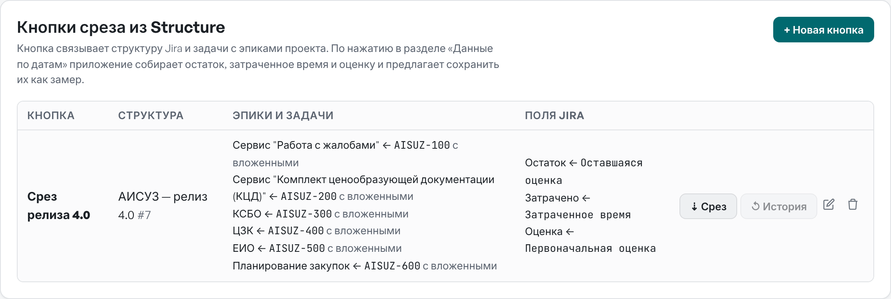

## Срез: затягивание данных на сегодня

Кнопки среза появляются в разделе «Данные по датам» рядом с **Замер по всем эпикам** (видны руководителю проекта и администратору, когда подключение к Jira настроено).

1. Нажмите кнопку среза (например, **⇣ Срез релиза 4.0**). Пока Burndown обращается к Jira, на кнопке написано «Загрузка из Jira…».
2. Откроется окно «Срез из Jira» — то же окно замера по всем эпикам, но со значениями из Jira. **Дата замера** — сегодня; при необходимости выберите другую.
3. Под названием каждого эпика указано, сколько задач Jira учтено, и предупреждения, если они есть.
4. Проверьте значения, при необходимости поправьте и нажмите **Сохранить**.

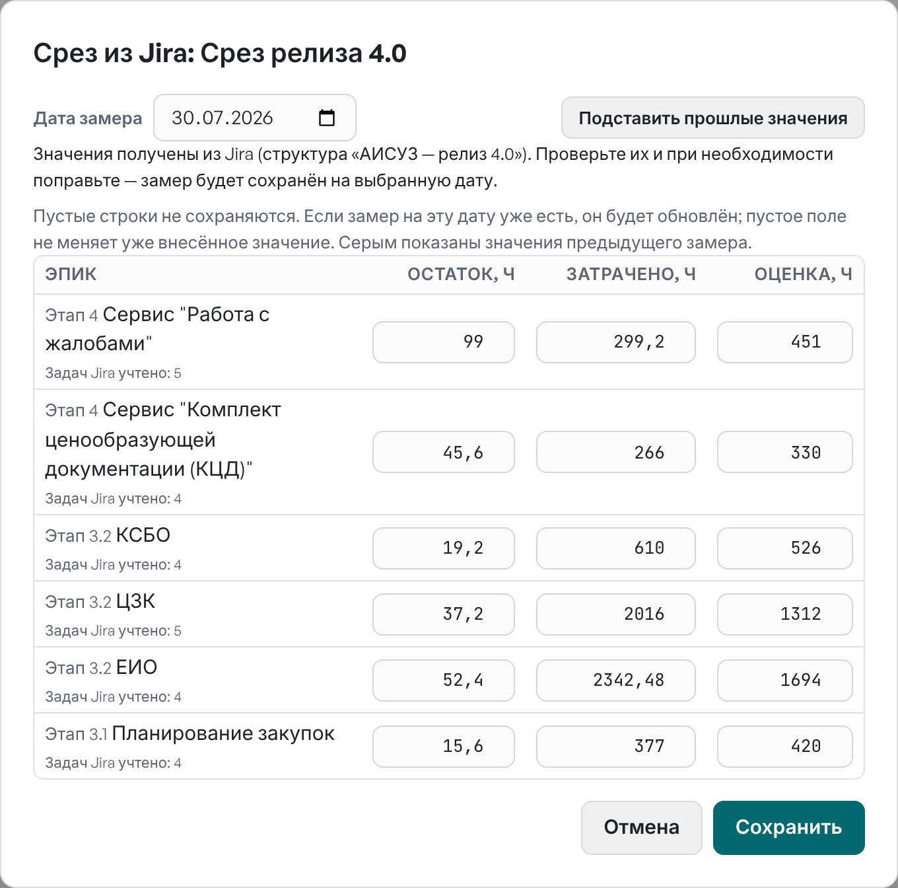{width=75%}

| Предупреждение | Что означает |
| --- | --- |
| «ABC-1: задача не найдена или нет прав на просмотр» | Ключ указан с ошибкой или учётной записи Jira не хватает прав |
| «ABC-5: задачи нет в структуре — учтена только она сама» | Задача не входит в выбранную структуру, поддерево не собрано |
| «N задач(и) структуры недоступны для просмотра — не учтены» | Часть задач поддерева скрыта от учётной записи Jira |
| «Поле … не числовое — метрика не заполнена» | В сопоставлении полей выбрано нечисловое поле |

> **Важно.** Первый успешный срез по кнопке открывает для неё автозаполнение по расписанию — появится сообщение «Первый срез получен — для кнопки доступно автозаполнение по расписанию». Срез считается успешным, если Jira вернула значения хотя бы по одному эпику.

## Восстановление истории

Если проект подключён к Jira недавно, графики начинаются с первого среза. Восстановление истории заполняет прошлые даты по журналу изменений Jira: Burndown смотрит, какими были остаток, затраченное время, оценка и статусы задач в конце каждого дня периода.

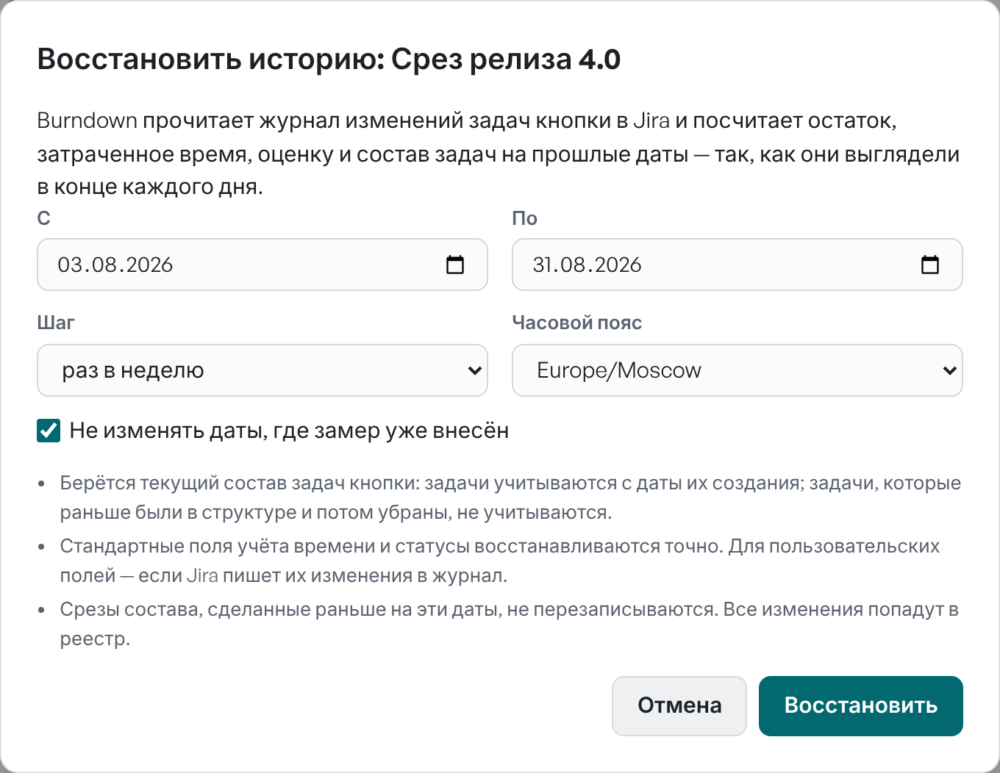{width=75%}

1. В «Связь с Jira» в строке кнопки нажмите **↺ История** (доступна после первого успешного среза).
2. Задайте период **С** и **По** (только прошедшие даты), **Шаг** — раз в неделю или каждый день, и **Часовой пояс**, в котором считается «конец дня».
3. **Не изменять даты, где замер уже внесён** — оставьте отмеченным, чтобы ручные замеры сохранились. Если снять отметку, значения из Jira заменят их (кроме показателей, которые Jira не вернула).
4. Нажмите **Восстановить**. Восстановление идёт на сервере: окно показывает прогресс, его можно закрыть — результат появится в таблице кнопок («история: … готово»).

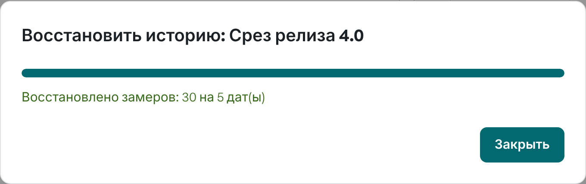{width=75%}

Что важно знать:

- берётся **текущий** состав задач кнопки: задачи учитываются с даты их создания в Jira; задачи, которые раньше входили в структуру и были из неё убраны, не учитываются;
- стандартные поля учёта времени и статусы восстанавливаются точно; пользовательские поля — если Jira записывает их изменения в журнал, иначе для прошлых дат берётся текущее значение (об этом будет предупреждение);
- для восстановленных дат сохраняется и состав задач — burn-up и разбор изменений сразу получают историю; срезы состава, сделанные раньше на эти даты, не перезаписываются;
- за один раз — не больше 370 дат; все созданные замеры попадают в реестр изменений.

## Автозаполнение по расписанию

В разделе «Автозаполнение» для каждой кнопки среза настраивается расписание: в заданные дни и время сервер сам забирает срез и сохраняет замер на текущую дату — открывать Burndown не нужно.

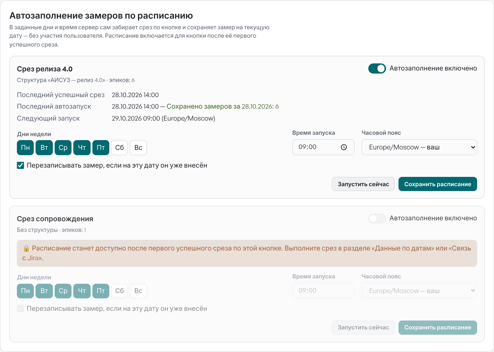

Пока по кнопке не было успешного среза, её карточка заблокирована с подсказкой «Расписание станет доступно после первого успешного среза по этой кнопке». Это гарантирует, что подключение, задачи и поля проверены вручную до того, как сервер начнёт сохранять данные сам.

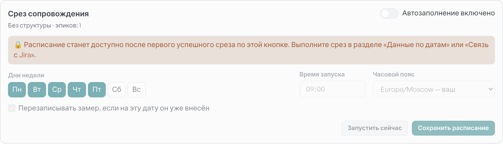

Настройка расписания:

1. Включите переключатель **Автозаполнение включено**.
2. Отметьте **Дни недели** (по умолчанию — будни).
3. Укажите **Время запуска** и **Часовой пояс**; ваш часовой пояс отмечен «— ваш».
4. **Перезаписывать замер, если на эту дату он уже внесён**: отметка включена — значения из Jira заменят внесённые за день; снята — замер, уже внесённый вручную, останется без изменений.
5. Нажмите **Сохранить расписание**.

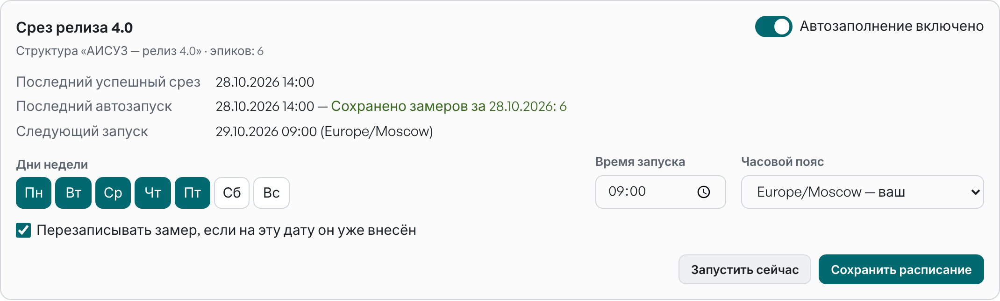

Карточка показывает:

- **Последний успешный срез** — когда Jira в последний раз вернула данные по этой кнопке;
- **Последний автозапуск** — время и результат: «Сохранено замеров за 28.10.2026: 6», число пропущенных замеров и предупреждений либо текст ошибки (красным);
- **Следующий запуск** — дата и время ближайшего запуска в часовом поясе расписания.

**Запустить сейчас** выполняет то же, что автоматический запуск: забирает срез и сохраняет замер на сегодня, без окна проверки. Удобно, чтобы проверить расписание или обновить данные перед совещанием.

Как работает автозапуск:

- запуск выполняется один раз в день на кнопку; если сервер был недоступен в момент запуска, срез выполнится позже в тот же день;
- если расписание включено после сегодняшнего времени запуска, первый автозапуск будет в следующий день по расписанию;
- показатели, для которых Jira ничего не вернула (или выбрано «не заполнять»), не затирают значения, уже внесённые за день;
- изменения записываются в реестр изменений от имени «Автозаполнение»;
- при ошибке Jira (например, истёк токен) замеры не сохраняются, а текст ошибки показывается в карточке.

> **Совет.** Выберите время, когда команда уже списала трудозатраты за предыдущий день, — например, 09:00. Тогда дашборд каждое утро показывает свежую картину без ручного ввода.

# Задачи Jira на дашборде

Каждый срез из Jira — ручной или автоматический — сохраняет не только суммы для замера, но и состав эпиков по задачам на день среза: ключ, тему, статус и значения каждой задачи. По этим срезам дашборд показывает, из чего складываются цифры замера. Блоки видят все участники проекта, в том числе в режиме просмотра; появляются они после первого среза.

## Задачи Jira по эпикам

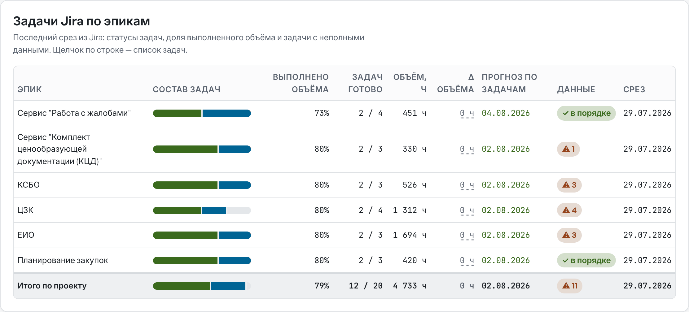

| Столбец | Что показывает |
| --- | --- |
| Состав задач | Полоса из трёх частей по числу задач: зелёная — готово, синяя — в работе, серая — не начато. Наведите курсор, чтобы увидеть числа |
| Выполнено объёма | Доля объёма закрытых задач в объёме эпика |
| Задач готово | Сколько задач закрыто из всех задач эпика |
| Объём, ч | Сумма объёма задач эпика |
| Δ объёма | Изменение объёма эпика с прошлого среза; щелчок открывает разбор «Что изменилось» |
| Данные | ✓ — данные в порядке; ⚠ N — у N задач неполные данные (подробности — в подсказке и в списке задач) |
| Срез | Дата последнего среза |

**Объём задачи** — её оценка, а если оценки нет — затрачено плюс остаток. Статус берётся из категории статуса Jira («К выполнению», «В работе», «Готово»), поэтому собственные статусы вашей Jira распределяются по трём группам автоматически. Задачи-контейнеры (эпик Jira или задача, под которой в структуре есть другие задачи) в число задач не входят, но их собственные значения учитываются в объёме — так же, как в замере.

Блок учитывает быстрые фильтры дашборда: скрытые эпики в нём не показываются. В PDF-отчёт дашборда попадает таблица с теми же данными.

## Объём и выполнение (burn-up)

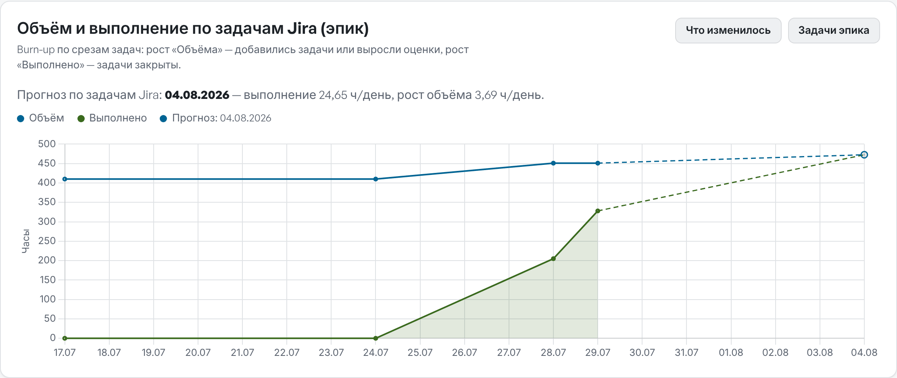

Под графиками выбранного эпика — burn-up по срезам задач:

- **Объём** — суммарный объём задач эпика на дату среза. Растёт, когда в эпик добавляют задачи или повышают оценки;
- **Выполнено** — объём закрытых задач. Растёт, когда задачи переходят в «Готово».

Burn-up отвечает на вопрос, который не видно по остатку: остаток уменьшился, потому что работа сделана, или потому что задачи переоценили. Если линия «Объём» растёт быстрее «Выполнено», срок под угрозой даже при снижающемся остатке. На один день приходится одна точка: повторный срез за день заменяет предыдущий.

**Прогноз по задачам.** По наклонам линий (темп выполнения и темп роста объёма, ч в день) Burndown считает, когда «Выполнено» догонит «Объём», и рисует пунктир до этой точки. Над графиком — дата и оба темпа; та же дата — в столбце **Прогноз по задачам** таблицы «Задачи Jira по эпикам» (зелёным — не позже цели, красным — позже). Если объём растёт не медленнее, чем выполняется, прогноз «не сходится»: при таком темпе работа не завершится. При скользящем методе burn rate темпы считаются по срезам окна.

Прогноз по задачам дополняет прогноз по остатку: он опирается на оценки задач и статусы в Jira, а не на внесённый остаток, и сразу учитывает рост объёма. Сильное расхождение двух прогнозов — повод проверить оценки задач и списание остатка.

## Список задач и качество данных

Щелчок по строке в «Задачах Jira по эпикам» или кнопка **Задачи эпика** над burn-up открывает список задач эпика из последнего среза. Ключ задачи — ссылка, открывающая задачу в Jira.

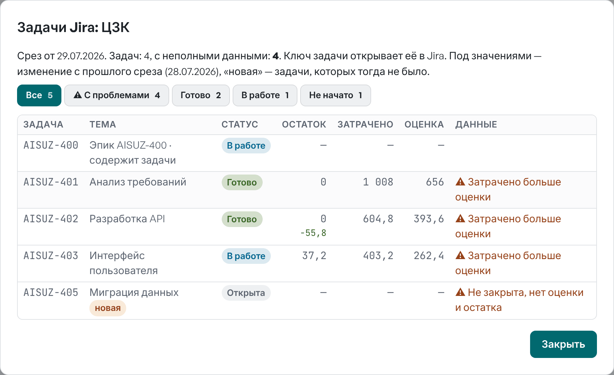{width=80%}

Кнопки над таблицей фильтруют список: **Все**, **С проблемами** и по статусам. В столбце **Данные** отмечены задачи, из-за которых суммы эпика могут вводить в заблуждение:

| Признак | Что не так | Как влияет на замер |
| --- | --- | --- |
| Не закрыта, нет оценки и остатка | Задача в работе или не начата, но не оценена | Остаток эпика занижен |
| Закрыта, но остаток не обнулён | Задача в «Готово», а остаток остался | Остаток эпика завышен |
| В работе, остаток 0 при ненулевой оценке | Остаток обнулили раньше закрытия | Остаток занижен, работа ещё идёт |
| Затрачено больше оценки | Перерасход по задаче | Сигнал недооценки похожих задач |

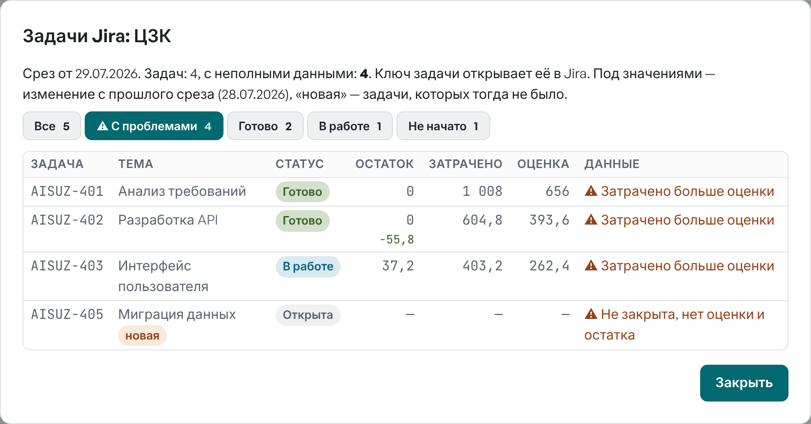{width=80%}

Проверки учитывают сопоставление полей кнопки: если показатель не берётся из Jira («не заполнять»), связанные с ним признаки не выставляются.

> **Совет.** Перед совещанием откройте задачи с отметкой ⚠ и попросите исполнителей поправить оценки в Jira. После следующего среза цифры замера станут точнее, а отметки исчезнут.

Если у эпика есть предыдущий срез, под значениями остатка, затраченного и оценки показано их изменение, а задачи, которых в прошлом срезе не было, отмечены «новая».

## Что изменилось между срезами

Щелчок по значению в столбце **Δ объёма** или кнопка **Что изменилось** над burn-up открывает разбор изменения объёма эпика между двумя срезами (по умолчанию — предпоследним и последним; даты меняются в полях **С** и **по**).

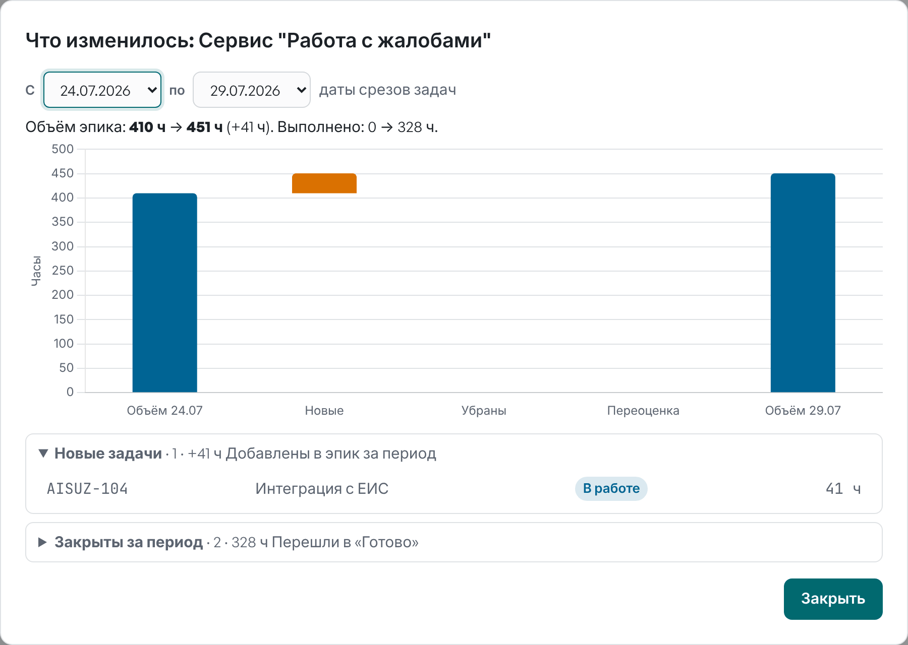{width=85%}

Каскадная диаграмма раскладывает изменение объёма на части:

| Часть | Что входит |
| --- | --- |
| **Новые** | Задачи, которых не было в эпике на первую дату |
| **Убраны** | Задачи, которые были на первую дату, но их нет на вторую (удалены, перенесены, убраны из структуры) |
| **Переоценка** | Изменение объёма задач, которые были на обе даты |

Объём на первую дату + новые − убранные ± переоценка = объём на вторую дату. Ниже диаграммы — списки задач по каждой части, а также задачи, **закрытые** и **переоткрытые** за период. Ключи задач открывают их в Jira.

# Режим просмотра

Пользователи с ролью «Пользователь» работают в режиме просмотра: над разделом показывается предупреждение, поля ввода недоступны, кнопки добавления, удаления, перетаскивания и среза из Jira скрыты, разделы «Настройки проекта», «Связь с Jira» и «Автозаполнение» в меню не отображаются.

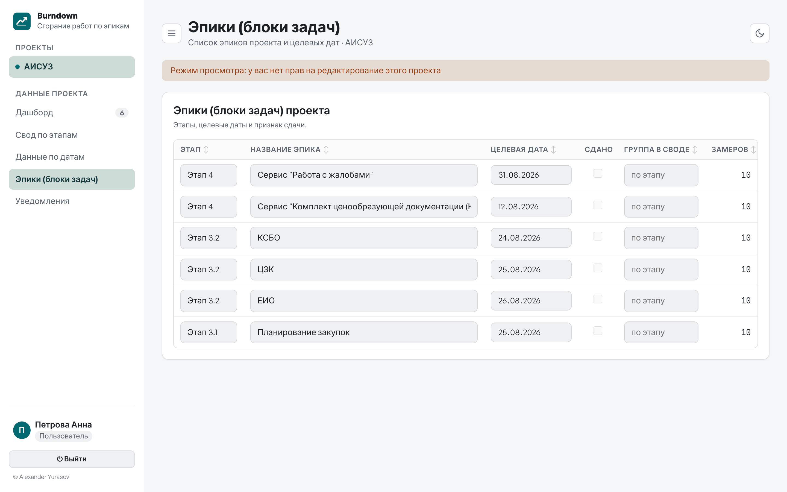

Остаются доступны фильтры, выбор эпика на графике, сортировка таблиц, период burn rate, выгрузка в PDF и печать, а также раздел «Уведомления» — подписка на дайджест и оповещения. Если у вас разные роли в разных проектах, режим переключается при смене проекта.

# Отчёты: PDF и печать

В разделах «Дашборд», «Свод по этапам» и «Данные по датам» кнопка **PDF** формирует на сервере отчёт с таблицами раздела:

- **Дашборд** — ключевые показатели, сводка по эпикам, burn rate за последние 5 дат и задачи Jira по эпикам (если есть срезы) с учётом выбранных эпиков;
- **Свод по этапам** — сводка по этапам и эпикам каждого этапа (сданные — если отмечено «Учитывать сданные эпики»);
- **Данные по датам** — все замеры по каждому эпику.

Кнопка **Печать** (дашборд и свод) печатает раздел вместе с графиками: меню и кнопки скрываются, страница подстраивается под альбомный A4. Чтобы получить PDF с графиками, выберите в диалоге печати «Сохранить как PDF».

# Уведомления: дайджест и оповещения

Burndown может сам присылать сводку по проекту и сообщать, когда сроки или данные ухудшились, — на почту и в Telegram. Подписка у каждого своя и настраивается в разделе «Уведомления» отдельно для каждого проекта. Подписаться может любой участник проекта, в том числе с ролью «Пользователь».

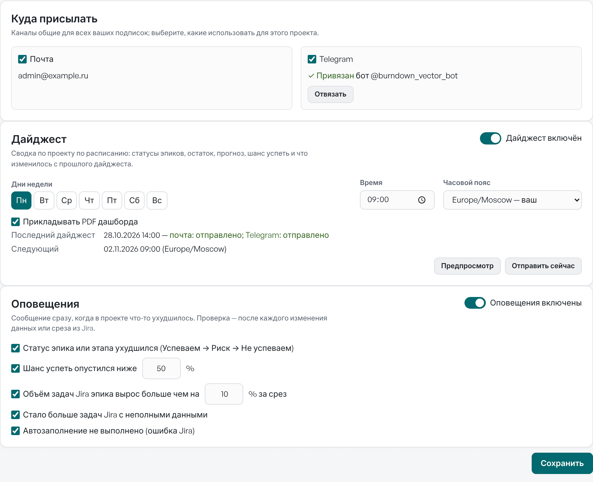

> **Важно.** Почту и Telegram-бота подключает администратор. Пока он этого не сделал, при сохранении появится сообщение «Администратор ещё не настроил отправку почты» или «Администратор ещё не подключил Telegram-бота».

## Каналы: почта и Telegram

В блоке «Куда присылать» отметьте один или оба канала:

- **Почта** — письма уходят на email из вашего профиля (он указан под отметкой). Email меняет администратор;
- **Telegram** — сообщения от бота Burndown в личный чат. Сначала Telegram нужно привязать.

Привязка Telegram — один раз для всех проектов:

1. Нажмите **Привязать Telegram**.
2. В окне откройте ссылку на бота и нажмите в Telegram **Запустить** (Start).
3. Вернитесь в Burndown и нажмите **Проверить**. Бот пришлёт подтверждение, а в карточке канала появится «✓ Привязан».

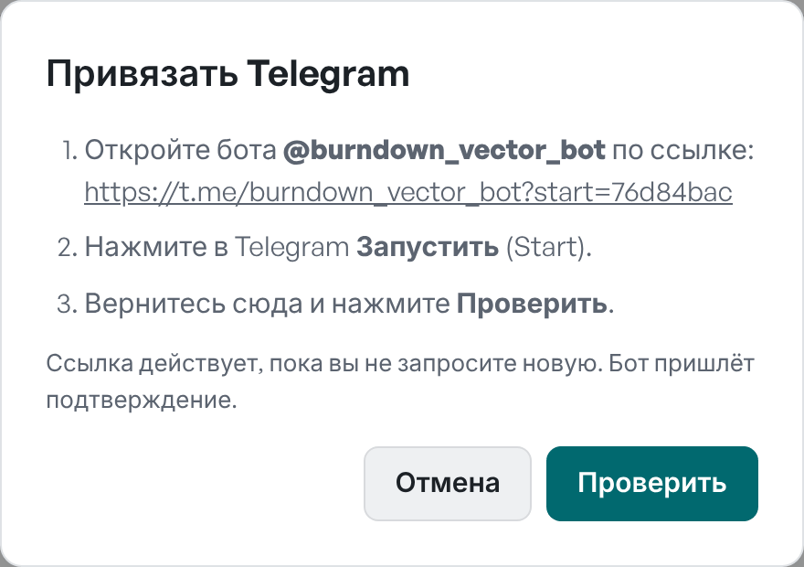{width=60%}

Ссылка действует, пока вы не запросите новую. **Отвязать** отключает Telegram во всех ваших подписках; привязать его снова можно в любой момент.

## Дайджест по расписанию

Дайджест — сводка по проекту на текущий день: сколько эпиков успевают, в риске и не успевают, общий остаток и таблица эпиков со статусом, остатком, прогнозом «0», целевой датой и шансом успеть. Цифры совпадают с дашбордом: сервер считает их по тем же правилам и настройкам прогноза проекта. Сданные эпики в дайджест не попадают.

Под названием эпика дайджест показывает, что изменилось с прошлого дайджеста: смену статуса, изменение шанса успеть в процентных пунктах и остатка в часах. Если автозаполнение завершилось ошибкой, её текст будет в отдельном блоке.

Настройка:

1. Включите переключатель **Дайджест включён**.
2. Отметьте **Дни недели** (по умолчанию — понедельник), укажите **Время** и **Часовой пояс**.
3. Отметьте **Прикладывать PDF дашборда**, если нужен отчёт целиком — тот же, что по кнопке **PDF** на дашборде.
4. Нажмите **Сохранить**.

Под настройками видны **Последний дайджест** — когда он отправлен и с каким результатом по каждому каналу — и **Следующий** — дата и время ближайшей отправки.

**Предпросмотр** показывает письмо, каким оно будет, если отправить его сейчас. **Отправить сейчас** присылает дайджест по выбранным каналам немедленно — удобно, чтобы проверить доставку. Такая отправка не меняет точку отсчёта «что изменилось»: её задаёт только дайджест по расписанию.

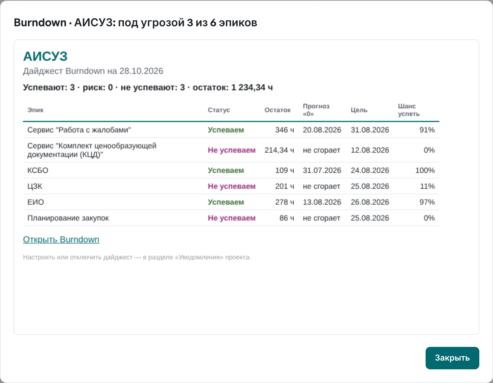

Как работает отправка:

- дайджест уходит один раз в день в выбранные дни; если сервер был недоступен в момент отправки, дайджест придёт позже в тот же день;
- если дайджест включён после сегодняшнего времени отправки, первый придёт в следующий день по расписанию;
- в Telegram приходит краткая версия: статус значком, остаток и шанс успеть по каждому эпику; PDF — отдельным файлом;
- если доступ к проекту отозван, дайджесты по нему больше не отправляются.

## Оповещения

Оповещение приходит сразу, когда в проекте что-то ухудшилось. Сервер проверяет проект после каждого изменения данных: замера, правки эпика или настроек, среза из Jira — ручного или автоматического. Включите переключатель **Оповещения включены** и отметьте нужные виды:

| Вид | Когда приходит |
| --- | --- |
| Статус ухудшился | Статус эпика или этапа сменился на худший: «Успеваем» → «Риск» → «Не успеваем» |
| Шанс успеть ниже порога | Шанс успеть к цели был не ниже порога и опустился ниже; порог — от 1 до 99% |
| Рост объёма | Объём задач Jira эпика вырос за срез больше чем на заданный процент (от 1 до 1000%) |
| Неполные данные | Стало больше задач Jira с проблемами: без оценки, закрытых с остатком и т. п. |
| Автозаполнение не выполнено | Автозапуск по кнопке среза завершился ошибкой Jira |

Если изменений несколько, они приходят одним сообщением списком. Отслеживаются только ухудшения: когда эпик возвращается в «Успеваем», сообщения нет. Сравнение ведётся с предыдущей проверкой, поэтому сразу после включения оповещений сообщений не будет — первое придёт при следующем ухудшении.

> **Совет.** Руководителю проекта удобно включить все виды оповещений и дайджест раз в неделю перед планёркой. Участнику, который только смотрит отчёты, обычно достаточно дайджеста.

# Работа с телефона

На телефоне боковое меню скрыто и открывается кнопкой **☰**; после выбора раздела оно закрывается само. Широкие таблицы прокручиваются по горизонтали, а таблица замеров и окно замера по всем эпикам показывают данные карточками: дата, остаток, затраченное время и оценка с подписями. Подсказку к шансу успеть показывает касание процента.

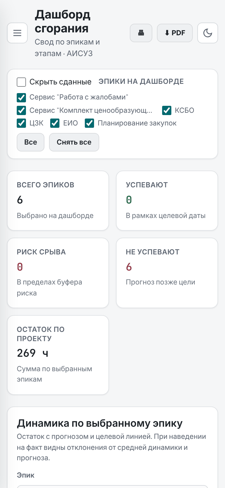{width=38%} 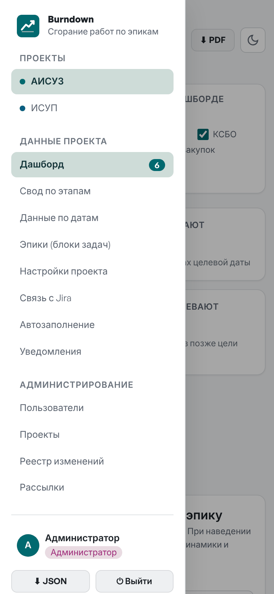{width=38%}

# Пользовательские сценарии

## Сценарий 1. Еженедельный замер вручную

**Кто:** руководитель проекта. **Цель:** обновить данные по всем эпикам и оценить сроки.

1. Открывает «Данные по датам» и нажимает **Замер по всем эпикам**.
2. Проверяет дату, нажимает **Подставить прошлые значения**, исправляет остаток и затраченное время, при изменении — оценку.
3. Нажимает **Сохранить** и переходит на «Дашборд»: статусы, Δ оценки, строки с отрицательным burn rate.
4. В «Своде по этапам» проверяет, что этапы укладываются в цели.

**Результат:** актуальная картина сроков за несколько минут.

## Сценарий 2. Связать проект с Jira и затянуть сегодняшний день

**Кто:** руководитель проекта, задачи команды ведутся в Jira со структурой Structure.

1. В «Связь с Jira» вводит адрес Jira и PAT, нажимает **Проверить подключение**, затем **Сохранить**.
2. Нажимает **+ Новая кнопка**, вводит название, **Загрузить из Jira** → выбирает структуру релиза.
3. У каждого эпика указывает ключ задачи-эпика Jira, оставляет **С вложенными**.
4. Проверяет поля Jira: стандартный учёт времени подходит; если команда ведёт трудозатраты в своём поле — **Загрузить поля из Jira** и выбирает его с единицей **часы**.
5. Сохраняет кнопку, открывает «Данные по датам», нажимает кнопку среза.
6. Сверяет значения и предупреждения в окне среза, нажимает **Сохранить**.

**Результат:** замер за сегодня по всем эпикам заполнен из Jira, для кнопки открыто автозаполнение.

## Сценарий 3. Ежедневное автозаполнение

**Кто:** руководитель проекта после первого успешного среза.

1. Открывает «Автозаполнение», включает переключатель у кнопки.
2. Оставляет будни, ставит время 09:00 и свой часовой пояс, оставляет **Перезаписывать замер**.
3. Нажимает **Сохранить расписание** и проверяет **Следующий запуск**.
4. На следующее утро видит в карточке «Сохранено замеров за …» и свежие графики на дашборде.

**Результат:** данные обновляются каждый рабочий день без участия человека.

## Сценарий 4. Ручная правка поверх автозаполнения

**Кто:** руководитель проекта, который хочет сам вносить оценку, а остаток и затраченное брать из Jira.

1. В редакторе кнопки для **Оценки** выбирает **— не заполнять —**.
2. Вносит оценку вручную в «Данных по датам».
3. Автозапуск обновляет остаток и затраченное время, а внесённая оценка остаётся.

**Результат:** часть показателей ведётся вручную, часть — из Jira.

## Сценарий 5. Завершение работ по эпику

1. Вносит последний замер с нулевым остатком.
2. В «Эпиках» ставит отметку **Сдано**.
3. На дашборде включает **Скрыть сданные**.
4. Убирает задачи Jira этого эпика из кнопки среза, чтобы автозаполнение больше не создавало по нему замеры.

## Сценарий 6. Разбор роста объёма перед совещанием

**Кто:** руководитель проекта, у эпика выросла Δ оценки.

1. На дашборде выбирает эпик и смотрит burn-up: линия «Объём» пошла вверх.
2. Нажимает **Задачи эпика** и сравнивает список с прошлой неделей: появились новые задачи или выросли оценки.
3. Включает фильтр **С проблемами** и пересылает исполнителям задачи без оценки и закрытые с остатком.
4. После правок в Jira нажимает кнопку среза или ждёт автозаполнения.

**Результат:** на совещании понятно, откуда взялся рост, и данные в Jira приведены в порядок.

## Сценарий 7. Новый проект с историей из Jira

**Кто:** руководитель проекта, Jira ведётся давно, Burndown подключают сейчас.

1. Создаёт кнопку среза и выполняет первый срез — сегодняшний замер готов.
2. Нажимает **↺ История**, выбирает период с начала релиза, шаг — раз в неделю, и запускает восстановление.
3. Через минуту на дашборде видны графики сгорания за весь релиз, burn-up и шанс успеть к цели.
4. Включает автозаполнение, чтобы дальше данные пополнялись сами.

**Результат:** проект с первого дня в Burndown получает полноценную историю и прогноз.

## Сценарий 8. Еженедельный обзор для руководителя портфеля

**Кто:** руководитель нескольких направлений, смотрит проект целиком.

1. Открывает «Свод по этапам» → «Задачи Jira по этапам»: где выполнено меньше всего и где прогноз по задачам позже цели.
2. Выбирает **Весь проект** в burn-up и проверяет, сходятся ли линии.
3. На дашборде по проблемным эпикам смотрит «Дрейф прогноза»: срок стабилен или каждую неделю уезжает.
4. Для эпиков с растущим объёмом открывает «Что изменилось».

**Результат:** понятно, где проблема в темпе, а где в росте объёма, — и с кем говорить.

## Сценарий 9. Дайджест для заказчика и оповещения для себя

**Кто:** руководитель проекта; заказчик смотрит проект с ролью «Пользователь».

1. Руководитель в «Уведомлениях» привязывает Telegram и включает все виды оповещений.
2. Заказчик в «Уведомлениях» своего доступа отмечает **Почта**, включает дайджест по понедельникам в 09:00 и **Прикладывать PDF дашборда**.
3. Заказчик нажимает **Предпросмотр**, затем **Отправить сейчас** и проверяет письмо.
4. Когда утренний автозапуск показывает рост объёма или эпик переходит в «Риск», руководитель получает сообщение в Telegram и разбирает причину до того, как заказчик увидит её в дайджесте.

**Результат:** заказчик каждую неделю получает актуальную сводку, а руководитель узнаёт о проблемах в день их появления.

# Частые вопросы

**Не вижу нужный проект.** Доступ к проектам открывает администратор. Если проектов нет совсем, вместо разделов отображается сообщение «Нет доступных проектов».

**Поля серые, кнопок нет.** У вас роль «Пользователь» в этом проекте — режим просмотра. Для редактирования обратитесь к администратору.

**Статус «Нет цели».** Укажите целевую дату эпика («Эпики» или поле **Цель** на дашборде) либо этапа (**Цель этапа** в своде).

**Прогноз «не сгорает».** Остаток по замерам не уменьшается. Проверьте значения; если всё верно — работы не продвигаются.

**«Замер на эту дату уже есть».** Измените значения в существующей строке или используйте **Замер по всем эпикам** — окно обновит существующий замер.

**Нет кнопки среза в «Данных по датам».** Кнопки видны руководителю проекта и администратору, когда подключение к Jira сохранено и создана хотя бы одна кнопка.

**«Jira отклонила логин/токен (401)».** Проверьте тип подключения, логин и токен; у PAT и API-токенов бывает срок действия. Введите новый токен в «Связь с Jira» и сохраните.

**«Структура N не найдена или плагин Structure недоступен».** Проверьте номер структуры и права учётной записи Jira на неё. Если плагина Structure нет, используйте кнопку без структуры — подзадачи соберутся по связи «задача — подзадача».

**В окне среза пустые значения у эпика.** У задач не заполнены выбранные поля Jira, или все задачи недоступны — смотрите предупреждения под названием эпика.

**Переключатель автозаполнения неактивен.** По кнопке ещё не было успешного среза. Выполните срез в «Данных по датам» — переключатель станет доступен.

**Автозапуск не сработал утром.** Посмотрите **Последний автозапуск** в карточке: при ошибке там её текст. Если расписание включено после сегодняшнего времени запуска, первый запуск будет на следующий день. При длительной недоступности сервера обратитесь к администратору.

**Нет блока «Задачи Jira по эпикам».** Он появляется после первого среза из Jira (ручного или автоматического) и показывает только эпики, выбранные в быстрых фильтрах.

**В столбце «Шанс успеть» прочерк.** У эпика меньше трёх замеров остатка или не задана целевая дата.

**Шанс 0%, хотя статус не «Не успеваем».** В истории замеров остаток чаще рос, чем сгорал, поэтому в большинстве сценариев он не обнуляется. Проверьте замеры и Δ оценки.

**Дрейфа прогноза нет на дашборде.** Нужно хотя бы два замера остатка у выбранного эпика.

**«Прогноз по задачам» — «не сходится».** За период срезов объём задач эпика рос не медленнее, чем закрывались задачи. Посмотрите «Что изменилось» — какие задачи добавлялись.

**Прогноз по задачам и прогноз «0» сильно различаются.** Первый считается по оценкам и статусам задач Jira, второй — по внесённому остатку. Расхождение обычно значит, что остаток в Jira не списывается вместе с работой или оценки задач устарели.

**История восстановилась с нулём замеров.** На выбранные даты задач кнопки ещё не было (созданы позже) или замеры на эти даты уже внесены и отмечено «Не изменять даты, где замер уже внесён».

**Число задач меньше, чем в Jira.** В число задач не входят задачи-контейнеры (эпик Jira, задачи с вложенными), а также задачи, недоступные учётной записи Jira, — о них предупреждает окно среза.

**Не приходит дайджест.** Посмотрите **Последний дайджест** в «Уведомлениях»: при ошибке там её текст. Проверьте дни, время и часовой пояс, а также папку «Спам». **Отправить сейчас** проверяет доставку сразу. Если ошибка в настройках почты или бота, обратитесь к администратору.

**Бот не находит привязку.** Нажмите **Запустить** (Start) именно в чате, открытом по ссылке из окна, и только потом **Проверить**. Если вы запросили новую ссылку, старая больше не действует.

**Оповещение не пришло, хотя эпик в «Не успеваем».** Оповещение приходит в момент ухудшения. Если эпик уже был в этом статусе, когда вы включили оповещения, сообщения не будет — его состояние видно в дайджесте.

**«Слишком много неудачных попыток входа».** После 10 неверных паролей подряд вход под этим логином закрыт на 15 минут. Подождите или попросите администратора задать новый пароль.

**После смены пароля пришлось войти заново на другом устройстве.** Так и задумано: смена пароля завершает все другие сессии учётной записи.

**«Нет связи с сервером — изменения не сохранены».** Проверьте сеть и повторите ввод: прежнее значение в поле уже восстановлено.

**После обновления интерфейс выглядит странно.** Обновите страницу с очисткой кэша: Ctrl+F5 (на macOS — Cmd+Shift+R).

# Глоссарий

| Термин | Определение |
| --- | --- |
| Burn rate | Скорость сгорания остатка, часов в день |
| Δ оценки | Изменение оценки от первого до последнего замера |
| PAT | Personal Access Token — персональный токен доступа Jira Server/DC |
| API-токен | Токен доступа Jira Cloud, создаётся на id.atlassian.com |
| Structure | Плагин Jira (Tempo) для иерархических структур задач |
| Поддерево | Задача и все задачи, вложенные в неё в структуре |
| Срез | Значения остатка, затраченного времени и оценки, собранные из Jira на момент запроса |
| Автозаполнение | Автоматический срез и сохранение замера по расписанию |
| Burn-up | График объёма задач и выполненного объёма по датам срезов |
| Объём задачи | Оценка задачи, а если её нет — затрачено плюс остаток |
| Задача-контейнер | Задача, под которой в структуре или по связи «подзадача» есть другие задачи |
| Монте-Карло | Метод прогноза: многократное моделирование будущего по реальным интервалам между замерами |
| P15, P50, P85 | Даты, к которым завершается 15%, 50% и 85% смоделированных сценариев |
| Журнал изменений | История изменений задачи в Jira — по ней восстанавливаются прошлые значения |
| Дрейф прогноза | Изменение прогнозной даты завершения от замера к замеру |
| Прогноз по задачам | Дата, когда «Выполнено» догонит «Объём» на burn-up при текущих темпах |
| Целевая линия | Требуемая траектория остатка к нулю на целевую дату |
| Буфер риска | Допустимое опоздание прогноза, при котором статус — «Риск» |
| Дайджест | Сводка по проекту, которую Burndown присылает по расписанию на почту или в Telegram |
| Оповещение | Сообщение об ухудшении сроков или данных проекта сразу после изменения |
